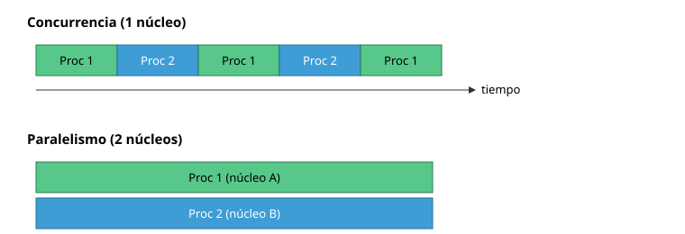
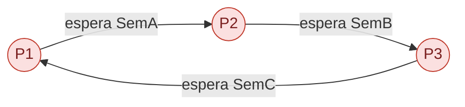
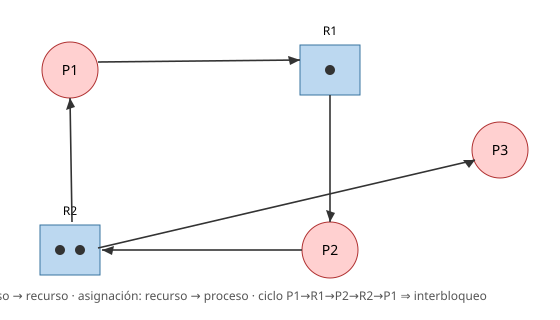
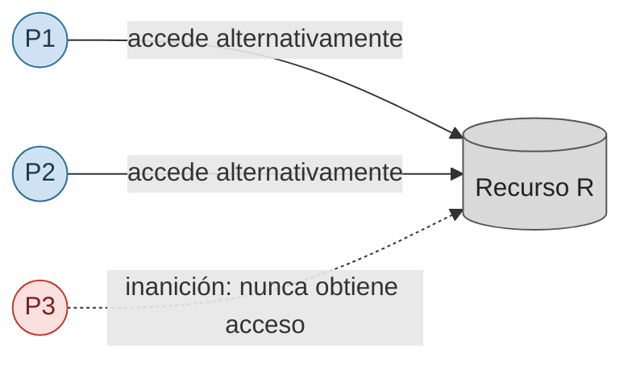
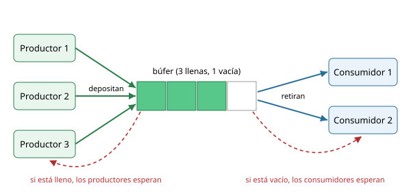
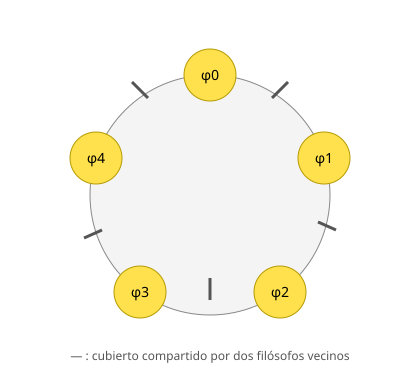
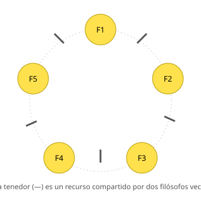

# Sincronización de procesos

## Por qué sincronizar

Varios procesos son **concurrentes** cuando su ejecución se solapa en el tiempo:

- En un solo núcleo de ejecución, los procesos se **intercalan**: no hay paralelismo, pero se aprovechan mejor los recursos (mientras un proceso espera la lectura de un archivo, otro proceso puede usar la CPU).
- Con varios núcleos se ejecutan en **paralelo**, cada proceso en un núcleo distinto.



A priori no sabemos el orden de ejecuión de los procesos, ya que el planificador ([planificación de procesos](../planificacion-de-procesos/)) los para y pone en ejecución de forma dinámica. Si un proceso depende de lo que hace otro (que haya terminado, dejado datos, dejado de usar algo), hay que **sincronizar** los procesos explícitamente. Y sincronizar bien es difícil, como se verá [al final del tema](#para-terminar-sincronizar-bien-es-difícil).

## Tipos de sincronización

| Qué queremos | Ejemplo que ya conoces | Mecanismo |
|---|---|---|
| [Esperar a que otro proceso termine](#esperar-a-otro-proceso) | El padre espera al hijo ([procesos](../../PRACTICA/procesos/)) | `waitpid` |
| [Esperar un aviso de otro proceso](#esperar-a-otro-proceso) (A antes que B) | `pause` hasta que llega una señal ([señales](../../PRACTICA/senales/)) | señal, semáforo a 0 |
| [Esperar datos de otro proceso](#esperar-datos-paso-de-mensajes) | `read` de un pipe ([pipes y fifos](../../PRACTICA/pipes-y-fifos/)), `msgrcv` ([colas de mensajes](../../PRACTICA/colas-de-mensajes/)) | pipe, FIFO, cola de mensajes |
| [Exclusión mutua](#exclusión-mutua): solo un proceso a la vez | `banco` y `transferencias` ([memoria compartida y semáforos](../../PRACTICA/memoria-compartida-y-semaforos/)) | semáforo a 1 |
| [Limitar a N procesos a la vez](#limitar-a-n-procesos) | `./seccion 22 2` ([memoria compartida y semáforos](../../PRACTICA/memoria-compartida-y-semaforos/)) | semáforo a N |
| [Barrera](#barreras): esperar a que lleguen todos | El padre espera a todos sus hijos | contador + semáforos |

Casi todas se resuelven **bloqueando** al proceso hasta que se cumple la condición. La herramienta general para hacerlo es el semáforo.

## Semáforos

Un **semáforo** es un contador entero no negativo, compartido por varios procesos, con dos operaciones **atómicas** (se ejecutan sin que nadie pueda interrumpirlas a medias):

- **acquire**: si el contador es mayor que 0, lo decrementa y el proceso sigue; si vale 0, **bloquea** al proceso hasta que otro proceso haga un release en el semáforo.
- **release**: incrementa el contador; si había procesos bloqueados, despierta a un proceso, que decrementará el contador y pasará.

Se puede ver el contador como el número de **fichas** disponibles:
- **acquire**: coge una ficha; si no queda ninguna, espera bloqueado a que alguien devuelva una.
- **release**: devuelve una ficha; si alguien estaba esperando, se la lleva y sigue.

El **valor inicial** del semáforo decide para qué sirve: 0 para esperar un aviso, 1 para exclusión mutua, N para dejar pasar hasta N procesos.

Los ejemplos de este tema usan estas macros para que se lean mejor:

```c
#define sem_acquire(id) semop(id, &(struct sembuf){ .sem_num = 0, .sem_op = -1 }, 1)
#define sem_release(id) semop(id, &(struct sembuf){ .sem_num = 0, .sem_op = 1 }, 1)
```

### Espera activa frente a bloqueo

Esperar comprobando una variable una y otra vez es **espera activa**: funciona, pero gasta CPU sin hacer nada útil. Un semáforo **bloquea** al proceso: no gasta CPU hasta que lo despiertan.

```c
for (; *listo == 0; ) { }                  /* espera activa: gasta CPU */

for (; *listo == 0; ) { sched_yield(); }   /* espera activa con cesión: cede la CPU en cada vuelta */

sem_acquire(sem_listo);                    /* bloqueo: no gasta CPU */
```

Con `sched_yield()` el proceso sigue comprobando la variable, pero en cada vuelta cede la CPU a otro proceso listo: es **espera activa con cesión** (*yield*).

## Esperar a otro proceso

**A que termine**: `waitpid` bloquea al padre hasta que el hijo acaba.

```c
pid_t pid = fork();
if (pid == 0) {
    hacer_trabajo();
    exit(0);
}
waitpid(pid, NULL, 0);   /* bloquea hasta que el hijo termina */
```

**A que avise** (A antes que B): B no debe empezar su trabajo hasta que A haya terminado el suyo. Con un semáforo `aviso` inicializado a **0**:

| Proceso A | Proceso B |
|---|---|
| `primer_trabajo();` | `sem_acquire(aviso);  /* espera a A */` |
| `sem_release(aviso);` | `segundo_trabajo();` |

Con [señales](../../PRACTICA/senales/) (`kill` + `pause`) también se puede, pero si la señal llega antes de que B llame a `pause`, el aviso se pierde:

| Proceso A | Proceso B |
|---|---|
| `primer_trabajo();` | `pause();`  |
| `kill(pid_b, SIGUSR1);` | `segundo_trabajo();`  |

El semáforo **recuerda** el aviso porque es un contador: si A hace el release antes, B pasa sin bloquearse. Siempre funciona.

## Esperar datos: paso de mensajes

Leer de un pipe vacío o hacer `msgrcv` sobre una cola vacía bloquea al proceso hasta que llegan datos: la comunicación ya sincroniza. En general, el **paso de mensajes** se basa en dos primitivas:

```text
send(destino, mensaje)
receive(origen, mensaje)
```

En cuanto a la sincronización hay **tres combinaciones**:

| Envío | Recepción | Nombre | Comentario |
|-------|-----------|--------|------------|
| Bloqueante | Bloqueante | **Síncrona** (*rendez‑vous*) | Emisor y receptor se bloquean hasta que llega el mensaje. |
| No bloqueante | Bloqueante | **Asíncrona** | El emisor continúa; el receptor se bloquea hasta recibir el mensaje. Así funcionan los pipes y las colas de mensajes: `write`/`msgsnd` vuelven enseguida (salvo que esté lleno) y `read`/`msgrcv` esperan a que haya datos. |
| No bloqueante | No bloqueante | **Totalmente asíncrona** | Nadie espera: el receptor tiene que comprobar una y otra vez si hay mensaje (sondeo), como `msgrcv` con `IPC_NOWAIT`. |

Ver [pipes y fifos](../ipc-pipes-y-fifos/) y [colas de mensajes](../ipc-colas-de-mensajes/).

## Exclusión mutua

Cuando varios procesos modifican los mismos datos, solo uno debe hacerlo a la vez.

### El problema: condiciones de carrera

Una **condición de carrera** aparece cuando el resultado depende del orden imprevisible en que varios procesos (o hilos) acceden a un dato compartido. Por ejemplo, dos hilos que incrementan 10 millones de veces la misma variable:

```c
#include <stdio.h>
#include <pthread.h>

long contador = 0;   /* compartida por los dos hilos */

void *incrementar(void *arg) {
    for (int i = 0; i < 10000000; i++) {
        contador++;
    }
    return NULL;
}

int main(void) {
    pthread_t h1, h2;
    pthread_create(&h1, NULL, incrementar, NULL);
    pthread_create(&h2, NULL, incrementar, NULL);
    pthread_join(h1, NULL);
    pthread_join(h2, NULL);
    printf("%ld\n", contador);   /* casi nunca 20000000 */
}
```

Cada ejecución da un resultado distinto, casi siempre menor que 20 millones. El motivo es que `contador++` no es atómico: la CPU lo hace en tres pasos (leer la variable en un registro, sumar 1, escribir). Normalmente un hilo hace los tres pasos seguidos y después el otro:

| Hilo 1 | Hilo 2 | `contador` |
|---|---|---|
| `r1 = contador;  /* 0 */` | | 0 |
| `r1++;           /* 1 */` | | 0 |
| `contador = r1;` | | 1 |
| | `r2 = contador;  /* 1 */` | 1 |
| | `r2++;           /* 2 */` | 1 |
| | `contador = r2;` | 2 |

Pero si el planificador cambia de hilo entre esos pasos, o los dos núcleos los ejecutan a la vez, los pasos se entrelazan y un incremento se pierde:

| Hilo 1 | Hilo 2 | `contador` |
|---|---|---|
| `r1 = contador;  /* 0 */` | | 0 |
| | `r2 = contador;  /* 0 */` | 0 |
| `r1++;           /* 1 */` | | 0 |
| | `r2++;           /* 1 */` | 0 |
| `contador = r1;` | | 1 |
| | `contador = r2;` | 1 |

El mismo problema aparece en `transferencias` ([memoria compartida y semáforos](../../PRACTICA/memoria-compartida-y-semaforos/), ejercicio 4): `cuentas[a] -= cantidad` también es leer, operar y escribir, y el total del banco cambia.

### La solución: proteger la sección crítica con un semáforo

La parte del código que accede al dato compartido es la **sección crítica**. Hay **exclusión mutua** cuando sólo 1 proceso puede estar ejecutando esa sección de código. Se consigue con un semáforo inicializado a **1**:

```c
void *incrementar(void *arg) {
    for (int i = 0; i < 10000000; i++) {
        sem_acquire(sem_contador);   /* sem_contador inicializado a 1 */
        contador++;                  /* sección crítica */
        sem_release(sem_contador);
    }
    return NULL;
}
```

Ahora el resultado es siempre 20 millones.

Un semáforo a 1 tiene una única ficha, que funciona como una llave: mientras un proceso la tiene y está en la sección crítica, los demás esperan; cuando la libera, otro puede tomarla. Un semáforo así también se llama **mutex** (de *mutual exclusion*).

### Variables atómicas

Si la sección crítica es **una sola operación sobre una variable**, como `contador++`, no hace falta un semáforo: C11 tiene variables **atómicas** (`<stdatomic.h>`), cuyas operaciones hace la CPU en un solo paso:

```c
#include <stdatomic.h>

atomic_long contador = 0;   /* compartida por los dos hilos */

void *incrementar(void *arg) {
    for (int i = 0; i < 10000000; i++) {
        atomic_fetch_add(&contador, 1);   /* leer, sumar y escribir en un solo paso */
    }
    return NULL;
}
```

Ventajas frente al semáforo:

- **Mucho más rápido**: con el semáforo, cada incremento son dos llamadas al sistema (`semop`); la operación atómica es una sola instrucción y no entra en el kernel.
- **Nadie se bloquea**: ningún proceso se queda dormido esperando, así que no hay cambios de contexto ni puede haber interbloqueo.
- **Más sencillo**: no hay que crear, inicializar ni borrar ningún semáforo, ni acordarse de hacer el release.
- Funciona también **entre procesos** si la variable está en [memoria compartida](../../PRACTICA/memoria-compartida-y-semaforos/).

Su límite: solo protege **una** operación sobre **una** variable. En `transferencias` hay dos variables que deben cambiar juntas (nadie debe ver el dinero restado de una cuenta y aún no sumado a la otra), y para eso hace falta el semáforo:

```c
sem_acquire(sem_cuentas);   /* sem_cuentas inicializado a 1 */
cuentas[a] -= cantidad;
cuentas[b] += cantidad;
sem_release(sem_cuentas);
```

### Limitar la sección a N procesos

Con el semáforo inicializado a **N**, pueden estar dentro hasta N procesos a la vez: N conexiones, N impresoras, el aforo de una sala. Es el `./seccion 22 2` de [memoria compartida y semáforos](../../PRACTICA/memoria-compartida-y-semaforos/) (ejercicio 5).

## Barreras

Una **barrera** es un punto del código en el que cada proceso espera a que lleguen todos los demás antes de seguir. Sirve para dividir un trabajo en fases: nadie empieza la fase 2 hasta que todos han acabado la fase 1. 

Con N procesos y un semáforo inicializado a N, cada proceso resta 1 al llegar y después espera a que el semáforo valga 0 (`sem_op = 0`):

```c
/* barrera inicializada a N */

semop(barrera, &(struct sembuf){ .sem_op = -1 }, 1);   /* he llegado */
semop(barrera, &(struct sembuf){ .sem_op = 0 }, 1);    /* espera a que lleguen todos (valor 0) */
```

<details> <summary> GPU y membarrier </summary>
La misma idea aparece en las **GPU**, donde miles de hilos avanzan por fases y se sincronizan por bloques (`__syncthreads()` en CUDA). Las **barreras de memoria** (*memory barriers*) son otra cosa con nombre parecido: no esperan a otros procesos, sino que obligan a que las lecturas y escrituras anteriores se completen antes que las posteriores, porque la CPU y el compilador pueden reordenarlas (instrucciones como `mfence` en x86, o la llamada `membarrier()` de Linux).
</details>

## Interbloqueo

El **interbloqueo** (bloqueo mutuo o *deadlock*) es el bloqueo **permanente** de un conjunto de procesos: cada uno espera algo que solo puede darle otro proceso del conjunto, que a su vez está esperando. 

Como cuatro vehículos que entran a la vez en un cruce estrecho: cada uno conserva el espacio que ocupa mientras espera el que ocupa el siguiente, y la espera circular impide que cualquiera avance.


Interbloqueos que se pueden dar en las prácticas:

- **Dos semáforos pedidos en distinto orden**:

  | Proceso A | Proceso B |
  |---|---|
  | `sem_acquire(sem_a);` | `sem_acquire(sem_b);` |
  | `sem_acquire(sem_b);` | `sem_acquire(sem_a);  /* cada uno espera al otro */` |

- **`waitpid` antes de leer un pipe**: el padre espera a que el hijo termine, pero el hijo se bloquea en `write` porque el pipe está lleno (64 KB en Linux) y nadie lo vacía.
- **Dos procesos que se leen mutuamente**: cada uno hace `read` del pipe del otro antes de escribir en el suyo.

### Condiciones de Coffman (1971)

Necesarias (aunque no suficientes) para que se produzca interbloqueo; deben cumplirse **simultáneamente**:

| Condición | Significado |
|-----------|-------------|
| **Exclusión mutua** | Existe al menos un recurso al que solo puede acceder un proceso a la vez. |
| **Posesión y espera** | Un proceso retiene un recurso mientras espera otro que tiene otro proceso. |
| **No apropiación** | Los recursos no se pueden quitar; solo los libera voluntariamente quien los tiene. |
| **Espera circular** | `P₀` espera un recurso de `P₁`, que espera uno de `P₂`, …, que espera uno de `P₀`. |



### Resolución del interbloqueo

- **Prevención**: impedir que se cumpla alguna de las condiciones de Coffman; por ejemplo, pedir los semáforos siempre en el mismo orden evita la espera circular.
- **Evitación**: conocer de antemano los recursos que necesitará cada proceso y conceder cada petición solo si el sistema queda en un **estado seguro** (algoritmo del banquero, en [`material_adicional.md`](material_adicional.md)).
- **Detección**: construir periódicamente el **grafo de asignación de recursos**; si hay un ciclo, hay interbloqueo, y se rompe terminando alguno de los procesos implicados para liberar sus recursos.

### Grafo de asignación de recursos

Una asignación concreta de recursos a procesos se representa con un grafo en el que:

- Los **círculos** representan procesos y los **cuadrados** representan recursos.
- Cada cuadrado tiene tantos **puntos** en su interior como instancias haya de ese recurso.
- Los **arcos son dirigidos**: de proceso a recurso indican **petición**; de recurso a proceso indican **asignación**.



## Inanición

Un proceso sufre **inanición** cuando se queda indefinidamente sin acceder a un recurso porque siempre se prefiere a otros. Si P₁, P₂ y P₃ necesitan un recurso R y se concede alternativamente a P₁ y P₂; entonces P₃ puede no obtenerlo nunca. No es un interbloqueo porque P₁ y P₂ siguen avanzando.



Ejemplos: los mensajes normales cuando no paran de llegar urgentes ([colas de mensajes](../../PRACTICA/colas-de-mensajes/), ejercicio 4), o los procesos de baja prioridad en el [planificador de procesos](../../PRACTICA/planificador-de-procesos/). Se soluciona con **envejecimiento**: aumentar la prioridad de quien lleva mucho tiempo esperando ([planificación de procesos](../planificacion-de-procesos/)).

## Patrones de concurrencia comunes

### Productor‑consumidor

Unos procesos (**productores**) generan datos y otros (**consumidores**) los procesan, cada uno a su ritmo. Entre ellos hay un **búfer** de tamaño limitado que absorbe las diferencias de velocidad: el productor solo espera si el búfer está lleno y el consumidor solo si está vacío.



Ejemplos:

- [Acueducto](../../PRACTICA/ejercicio-procesos-y-pipes/): la pipe es un búfer (64 KB) entre un productor y un consumidor.
- `encolador` → `procsched` en [planificador de procesos](../../PRACTICA/planificador-de-procesos/): el encolador produce comandos en la cola de mensajes y el planificador los consume.
- Los productores y consumidores de [colas de mensajes](../../PRACTICA/colas-de-mensajes/) (ejercicios 2 y 3).
- **Cola de impresión**: las aplicaciones dejan trabajos y el servicio de impresión los envía a las impresoras.
- **Audio y vídeo**: el descodificador produce muestras y la tarjeta de sonido las consume a ritmo fijo; si el búfer se vacía, se oye un corte.
- **Tarjeta de red**: deposita los paquetes recibidos en un búfer y el kernel los consume.
- **Servidor con hilos trabajadores**: un hilo acepta peticiones y las deja en una cola, y varios trabajadores las atienden (un productor, varios consumidores).

Con un pipe o una cola de mensajes el kernel ya lo resuelve: `write`/`msgsnd` bloquean si está lleno y `read`/`msgrcv` si está vacío. 

<details> <summary> Con memoria compartida habría que hacerlo a mano. </summary>
`buffer[N]`, `*cabeza` y `*cola` en memoria compartida, y tres semáforos (`lleno = 0`, `vacio = N`, `sem_indices = 1`):

| Productor | Consumidor |
|---|---|
| `sem_acquire(vacio);` | `sem_acquire(lleno);` |
| `sem_acquire(sem_indices);` | `sem_acquire(sem_indices);` |
| `buffer[*cabeza] = dato;` | `int dato = buffer[*cola];` |
| `*cabeza = (*cabeza + 1) % N;` | `*cola = (*cola + 1) % N;` |
| `sem_release(sem_indices);` | `sem_release(sem_indices);` |
| `sem_release(lleno);` | `sem_release(vacio);` |

- `lleno` cuenta las casillas ocupadas y `vacio` las libres; `sem_indices` protege los índices cuando hay varios productores o varios consumidores (con uno de cada, sobra).
- El orden importa: si el productor hiciera `sem_acquire(sem_indices)` antes que `sem_acquire(vacio)` con el búfer lleno, se bloquearía con `sem_indices` cogido y el consumidor ya no podría entrar a vaciarlo: interbloqueo.

</details>

### Lectores‑escritores

Varios procesos acceden a un mismo dato: los **lectores** pueden estar varios dentro a la vez, pero un **escritor** necesita estar solo (ningún escritor ni ningún lector).

<details> <summary> solucion con prioridad a los lectores </summary>

```c
/* sem_escritura = 1; sem_lectores = 1; *lectores (en memoria compartida) = 0 */

/* escritor */
sem_acquire(sem_escritura);
escribir();
sem_release(sem_escritura);

/* lector */
sem_acquire(sem_lectores);
(*lectores)++;
if (*lectores == 1) {
    sem_acquire(sem_escritura);   /* el primero bloquea a los escritores */
}
sem_release(sem_lectores);
leer();
sem_acquire(sem_lectores);
(*lectores)--;
if (*lectores == 0) {
    sem_release(sem_escritura);   /* el último los deja pasar */
}
sem_release(sem_lectores);
```

Mientras sigan llegando lectores, `*lectores` nunca vuelve a 0 y los escritores sufren **inanición**.

**Sin inanición**: un semáforo `turno` más hace que, cuando un escritor está esperando, los lectores nuevos se pongan en cola detrás de él.

```c
/* turno = 1 */

/* escritor */
sem_acquire(turno);       /* a partir de aquí no entran lectores nuevos */
sem_acquire(sem_escritura);
sem_release(turno);
escribir();
sem_release(sem_escritura);

/* lector: pasa por el turno y después sigue igual que antes */
sem_acquire(turno);
sem_release(turno);
sem_acquire(sem_lectores);
/* ... */
```
</details>

En la práctica no hace falta construirlo a mano POSIX lo ofrece como `pthread_rwlock_t`. Cuatro hilos leen un precio y uno lo modifica:

```c
#include <stdio.h>
#include <pthread.h>

pthread_rwlock_t cerrojo = PTHREAD_RWLOCK_INITIALIZER;
int precio = 100;   /* dato compartido */

void *lector(void *arg) {
    pthread_rwlock_rdlock(&cerrojo);   /* pueden entrar varios lectores a la vez */
    printf("precio: %d\n", precio);
    pthread_rwlock_unlock(&cerrojo);
    return NULL;
}

void *escritor(void *arg) {
    pthread_rwlock_wrlock(&cerrojo);   /* espera a que no haya nadie dentro */
    precio += 10;
    pthread_rwlock_unlock(&cerrojo);
    return NULL;
}

int main(void) {
    pthread_t hilos[5];
    for (int i = 0; i < 4; i++) {
        pthread_create(&hilos[i], NULL, lector, NULL);
    }
    pthread_create(&hilos[4], NULL, escritor, NULL);
    for (int i = 0; i < 5; i++) {
        pthread_join(hilos[i], NULL);
    }
}
```

- Quién tiene prioridad depende de la implementación: en Linux (glibc) los lectores, así que los escritores pueden sufrir inanición; se puede cambiar con `pthread_rwlockattr_setkind_np`.


### Filósofos comensales

Cinco filósofos se sientan alrededor de una mesa. Cada uno alterna `pensar()` y `comer()`, y para comer necesita **dos cubiertos**: el de su izquierda y el de su derecha. Hay tantos cubiertos como filósofos.



Solución directa, con un semáforo por cubierto:

```c
/* cubierto[0..4]: un semáforo por cubierto, inicializado a 1 */
for (;;) {
    pensar();
    sem_acquire(cubierto[i]);
    sem_acquire(cubierto[(i + 1) % 5]);
    comer();
    sem_release(cubierto[i]);
    sem_release(cubierto[(i + 1) % 5]);
}
```

Si **todos** cogen a la vez el cubierto de su izquierda, cada uno espera al de su derecha y hay **interbloqueo**.



Tres formas de evitarlo, cada una rompiendo una condición de Coffman:

1. **Siempre en el mismo orden**: cada filósofo coge primero el cubierto de número menor. El filósofo 4 coge primero el 0, y ya no puede formarse la espera circular.

   ```c
   int izq = i;
   int der = (i + 1) % 5;
   sem_acquire(cubierto[izq < der ? izq : der]);
   sem_acquire(cubierto[izq < der ? der : izq]);
   ```

2. **Como mucho cuatro sentados**: un semáforo `sillas` inicializado a 4 antes de coger los cubiertos. Con cuatro filósofos y cinco cubiertos, siempre hay uno que puede comer.

   ```c
   sem_acquire(sillas);
   /* coger cubiertos, comer, soltar cubiertos */
   sem_release(sillas);
   ```

3. **Los dos a la vez**: un `semop` con dos operaciones es atómico: coge los dos cubiertos o ninguno, así que nadie se queda con uno mientras espera el otro.

   ```c
   /* cubiertos: array de 5 semáforos, todos a 1 */
   struct sembuf coger[2] = {
       { .sem_num = i,           .sem_op = -1 },
       { .sem_num = (i + 1) % 5, .sem_op = -1 },
   };
   semop(cubiertos, coger, 2);
   ```

Otra solución, con un estado por filósofo, está en [`material_adicional.md`](material_adicional.md).

### Clientes‑servidor

Varios clientes envían peticiones a un servidor y esperan respuesta. Con una sola [cola de mensajes](../../PRACTICA/colas-de-mensajes/): los clientes envían con `mtype = 1` y su PID dentro del mensaje; el servidor responde usando ese PID como `mtype`, y cada cliente pide solo los mensajes de su tipo.

El servidor atiende peticiones en bucle y devuelve el cuadrado del número que le mandan:

```c
// servidor.c — responde a cada petición con el cuadrado del número
#include <stdio.h>
#include <sys/types.h>
#include <sys/ipc.h>
#include <sys/msg.h>

typedef struct {
    long  mtype;   /* 1 = petición; PID del cliente = respuesta */
    pid_t pid;     /* quién pregunta */
    long  num;     /* el número (petición) o su cuadrado (respuesta) */
} msg_t;

int main(void) {
    key_t clave = ftok("/etc", 22);
    int cola = msgget(clave, 0600 | IPC_CREAT);

    for (msg_t m;;) {
        msgrcv(cola, &m, sizeof(msg_t) - sizeof(long), 1, 0);   /* solo peticiones */
        printf("petición de %d: %ld\n", m.pid, m.num);
        m.mtype = m.pid;            /* la respuesta va al tipo del cliente */
        m.num = m.num * m.num;
        msgsnd(cola, &m, sizeof(msg_t) - sizeof(long), 0);
    }
}
```

```c
// cliente.c — pide al servidor el cuadrado de un número
#include <stdio.h>
#include <stdlib.h>
#include <unistd.h>
#include <sys/types.h>
#include <sys/ipc.h>
#include <sys/msg.h>

typedef struct {
    long  mtype;
    pid_t pid;
    long  num;
} msg_t;

int main(int argc, char *argv[]) {
    if (argc != 2) {
        fprintf(stderr, "Uso: %s <num>\n", argv[0]);
        return 1;
    }
    key_t clave = ftok("/etc", 22);
    int cola = msgget(clave, 0600 | IPC_CREAT);

    msg_t m = { .mtype = 1, .pid = getpid(), .num = atol(argv[1]) };
    msgsnd(cola, &m, sizeof(msg_t) - sizeof(long), 0);
    msgrcv(cola, &m, sizeof(msg_t) - sizeof(long), getpid(), 0);   /* solo la respuesta para mí */
    printf("%s al cuadrado = %ld\n", argv[1], m.num);
    return 0;
}
```

```bash
./servidor &
for i in $(seq 5); do ./cliente $i & done   # 5 clientes a la vez: cada uno recibe su resultado
```

El servidor sigue en marcha hasta `Ctrl-C` (o `kill`); la cola persiste y se borra con `ipcrm`.

## Nota del profesor: sincronizar bien es difícil

La concurrencia es una de las partes más difíciles de programar bien. Los errores dependen del orden en que el planificador ejecuta los procesos, o la CPU y el compilador reordenen las instrucciones. Los errores pueden aparecer una vez cada mil ejecuciones, solo en otra máquina, o desaparecer al añadir un `printf` o al usar el depurador.

Al sincronizar hay un compromiso:

- **Bloquear todo** : un único semáforo a 1 protege todos los datos. Es fácil de hacer bien, pero los procesos se esperan aunque no se molesten. En lectores-escritores, un solo semáforo para todos funciona, pero los lectores, que podrían leer a la vez, pasan de uno en uno. El ejemplo más conocido es el **GIL** (*Global Interpreter Lock*) de Python: un único cerrojo que solo deja ejecutar código Python a un hilo a la vez. Simplifica mucho el intérprete, pero varios hilos de Python no aprovechan varios núcleos. Para paralelismo real se usan procesos (`multiprocessing`). Desde Python 3.13 hay una versión experimental sin GIL.

- **Afinar**: cerrojos de lectura/escritura, un semáforo por dato, variables atómicas, colas de mensajes… Se aprovecha mejor el paralelismo, pero hay más piezas y más ocasiones de equivocarse: carreras, interbloqueos, inanición.

Por eso, salvo para aprender, **no conviene implementar estos mecanismos a mano**: es mejor usar los que ya ofrecen el sistema operativo y las bibliotecas, probados por mucha gente:

- pipes y colas de mensajes para productor-consumidor;
- `pthread_rwlock_t` para lectores-escritores;
- variables atómicas para contadores;
- las colas concurrentes del lenguaje (`queue.Queue` en Python, `java.util.concurrent` en Java).
