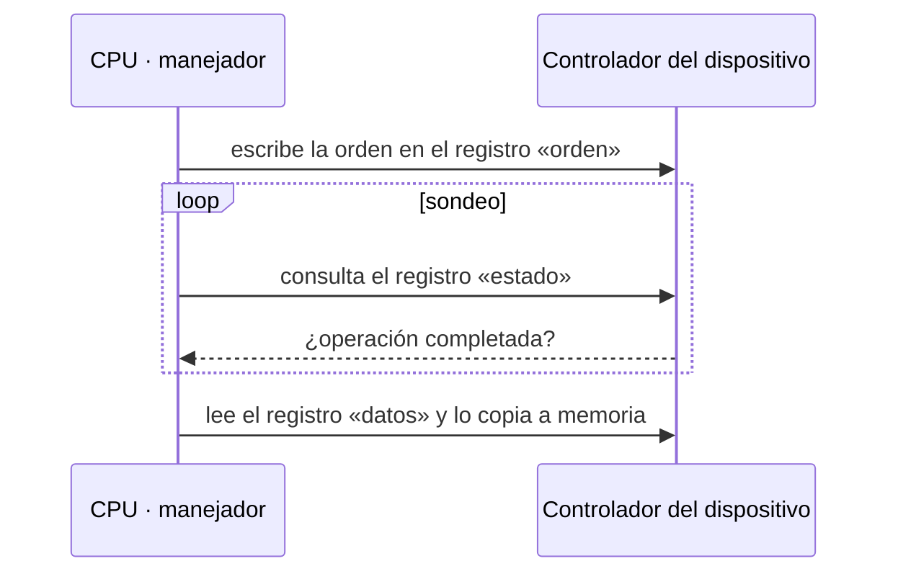
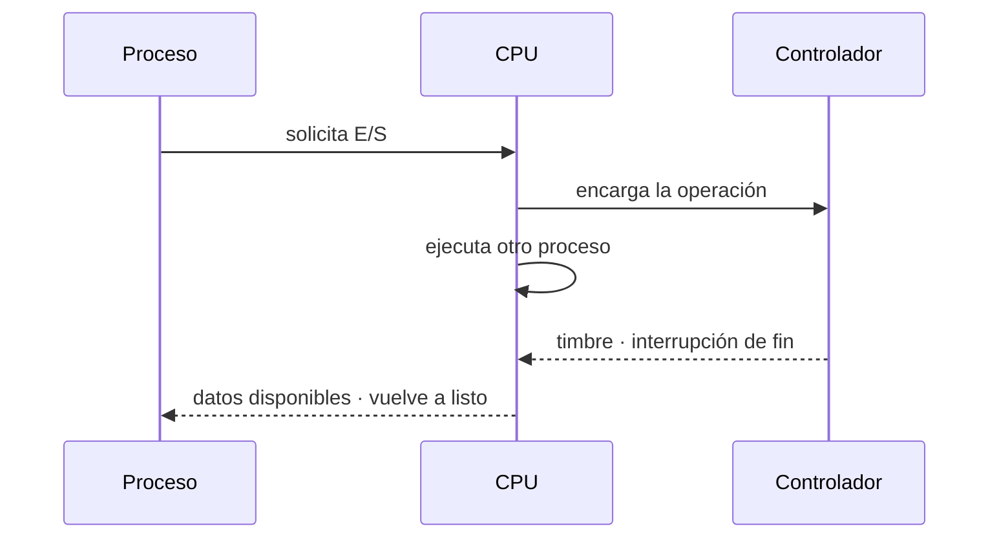
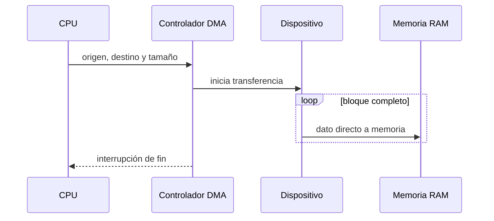
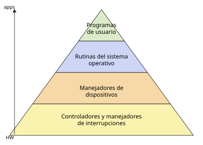
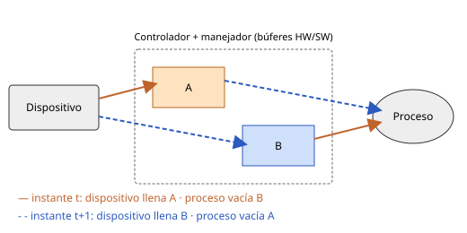
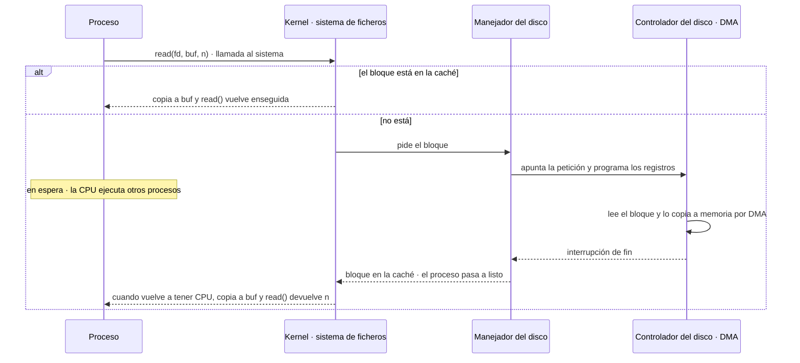

# Dispositivos de Entrada/Salida

## Dispositivo, controlador y manejador

Un dispositivo de E/S tiene dos partes hardware y una software:

- El **dispositivo** propiamente dicho: la parte mecánica o electrónica (platos y cabezales, teclas, sensor…).
- El **controlador**: la electrónica que lo gobierna. La CPU no habla con el dispositivo, sino con los **registros** de su controlador: **orden** (qué operación hacer), **estado** (ocupado, terminado, error) y **datos** (el dato leído o el que se va a escribir).
- El **manejador** (*driver*): el código del sistema operativo que sabe programar los registros de un controlador concreto.

En castellano «controlador» también se usa para traducir *driver* (Windows habla de «controladores de dispositivo»). En este tema, **controlador = hardware** y **manejador = software**.

La CPU accede a los registros del controlador de dos formas:

- **Puertos de E/S**: un espacio de direcciones aparte, con instrucciones privilegiadas propias (`in`/`out` en x86).
- **E/S mapeada en memoria**: los registros ocupan direcciones de memoria física y se leen y escriben con instrucciones normales (ya mencionada en [gestión de memoria](../gestion-de-memoria/#mapeo-de-ficheros-mmap)). Esas páginas se marcan **sin caché**: si no, la CPU leería una copia antigua del registro de estado. Es la forma habitual hoy.

### Dispositivos de bloque y de carácter

- **Bloque**: transfieren bloques de tamaño fijo (512 bytes en los discos antiguos, hoy normalmente 4096) y son **direccionables**: se puede leer o escribir cualquier bloque tras posicionarse. Discos duros, SSD, memorias USB.
- **Carácter**: producen o consumen un flujo de bytes **sin direcciones**. Teclado, ratón, puerto serie, terminal.

### Velocidades

| Dispositivo | Velocidad aproximada |
|-------------|----------------------|
| Teclado | 10 B/s |
| Ratón | 100 B/s |
| Disco duro (HDD) | 200 MB/s |
| SSD SATA | 550 MB/s |
| Red Ethernet de 10 Gb/s | 1,25 GB/s |
| SSD NVMe | 7 GB/s |

Entre el teclado y un SSD NVMe hay casi **nueve órdenes de magnitud**: ninguna técnica de E/S sirve igual de bien para todos.

## Comunicación entre la CPU y el controlador

Hay dos preguntas independientes:

- ¿**Cómo sabe la CPU** que el dispositivo ha terminado? Preguntándole una y otra vez (**sondeo**) o esperando a que él avise (**interrupción**).
- ¿**Quién copia los datos** entre el controlador y la memoria? La propia CPU (**E/S programada**) o un controlador de **DMA**.

Se ven de la solución más simple a la más eficiente: cada paso resuelve el problema del anterior.

### Sondeo

La CPU escribe la orden en el controlador y consulta el registro de estado en un bucle hasta que la operación termina (*polling*). Es **espera activa**, como la de [concurrencia y sincronización](../concurrencia-y-sincronizacion/#espera-activa-frente-a-bloqueo):



**Problema**: mientras espera, la CPU no hace nada útil. Con un teclado pasaría casi todo el tiempo dando vueltas en el bucle.

### Interrupciones

La CPU programa el controlador y se dedica a otra cosa (normalmente, a otro proceso). Cuando el controlador termina, activa una **interrupción** («timbre»): la CPU suspende lo que estaba haciendo y ejecuta la **rutina de servicio** del manejador, que copia el dato y despierta al proceso que lo esperaba. Es la **E/S dirigida por interrupciones**.



- Cómo guarda la CPU el contexto y salta a la rutina se ve en [espacio de usuario y espacio de kernel](../espacio-usuario-espacio-kernel/).
- Para saber **qué dispositivo** ha interrumpido, cada uno tiene un número (IRQ) que indexa una tabla con la dirección de su rutina: **interrupciones vectorizadas**. Sin esa tabla, el gestor de interrupciones tendría que preguntar (sondear) a cada controlador.

**Problema**: la CPU sigue copiando los datos uno a uno, con una interrupción por dato. Vale para un teclado, pero un disco generaría millones de interrupciones por segundo.

### DMA

Un controlador de **DMA** (*Direct Memory Access*, acceso directo a memoria) copia el bloque completo entre el dispositivo y la memoria sin pasar por la CPU. La CPU solo indica origen, destino y tamaño, y recibe **una interrupción al final** del bloque, no una por dato. Mientras tanto sigue ejecutando otros procesos, aunque algo más lenta: el DMA y la CPU comparten el bus de memoria y, cuando el DMA lo usa, la CPU tiene que esperar (**robo de ciclos**).



### Resumen

| | Aviso por **sondeo** | Aviso por **interrupción** |
|---|---|---|
| **Copia la CPU** (E/S programada) | Lo más simple; la CPU queda ocupada esperando. Microcontroladores sencillos. | Una interrupción por dato. Teclado, ratón. |
| **Copia el DMA** | Dispositivos muy rápidos: SSD NVMe, red con mucho tráfico. | Una interrupción por bloque. Discos, red. |

### ¿Cuándo compensa el sondeo?

Atender una interrupción no es gratis: hay que guardar el contexto, ejecutar la rutina de servicio, y el proceso despertado aún tiene que esperar su turno en la cola de listos. En total, unos pocos microsegundos.

- **Dispositivo lento** comparado con ese coste (teclado: cientos de milisegundos entre pulsaciones; disco duro: milisegundos): las interrupciones ganan de lejos, sondear sería tirar casi toda la CPU.
- **Dispositivo muy rápido** (SSD NVMe: unos 10 µs por lectura; red de 100 Gb/s: millones de paquetes por segundo): el coste de las interrupciones se acerca al de la propia operación y **sondear vuelve a compensar**.
- Lo habitual hoy es un esquema **híbrido**: una interrupción despierta al manejador y, mientras quede trabajo, sondea.

`/proc/interrupts` muestra cuántas interrupciones ha atendido cada CPU en cada línea (IRQ) y qué manejador la usa (salida recortada):

```text
$ cat /proc/interrupts
            CPU0       CPU1       CPU2       CPU3
   1:          0          0       2158          0  IR-IO-APIC    1-edge       i8042
 125:          0     184342          0          0  IR-PCI-MSI    327680-edge  xhci_hcd
 127:      51236          0          0          0  IR-PCI-MSI    1048577-edge nvme0q1
 128:          0      48877          0          0  IR-PCI-MSI    1048578-edge nvme0q2
 129:          0          0      50310          0  IR-PCI-MSI    1048579-edge nvme0q3
 130:          0          0          0      47702  IR-PCI-MSI    1048580-edge nvme0q4
 LOC:    4523109    4187322    4398001    4012877  Local timer interrupts
```

Con `watch -n 1 cat /proc/interrupts`, al teclear o mover el ratón sube el contador de `i8042` (teclado de portátil) o de `xhci_hcd` (controlador USB). `LOC` son las interrupciones del reloj de cada CPU, que usa el planificador.

## Capas de software de E/S



- El **manejador** oculta los detalles de un controlador concreto y ofrece al resto del sistema operativo una **interfaz común**, la misma para todos los dispositivos: `open`, `read`, `write`, `lseek`, `ioctl` (operaciones propias de cada dispositivo: velocidad del puerto serie, expulsar un disco…) y `close`.
- Por encima, el sistema operativo hace lo que es **independiente del dispositivo**: nombres, permisos, búferes, caché y tratamiento de errores.
- Los programas de usuario usan siempre las mismas llamadas al sistema, sea cual sea el dispositivo.

### En UNIX, todo es un fichero

- Cada dispositivo aparece como un **fichero especial** en `/dev`: se abre, se lee y se escribe con las mismas llamadas que un fichero normal. También hay dispositivos sin hardware detrás, como `/dev/null` o `/dev/urandom` (ver [pipes y fifos](../ipc-pipes-y-fifos/)).
- Cada fichero de dispositivo tiene:
  - **clase**: de bloque (`b`) o de carácter (`c`).
  - **número mayor** (*major number*): identifica el manejador, es decir, la familia de dispositivos.
  - **número menor** (*minor number*): se le pasa al manejador para distinguir entre varios dispositivos semejantes (cada disco, cada partición, cada terminal).

```text
$ ls -l /dev/null /dev/nvme0n1 /dev/sda /dev/sda1 /dev/tty1
crw-rw-rw- 1 root root   1, 3 Oct 23 09:12 /dev/null
brw-rw---- 1 root disk 259, 0 Oct 23 09:12 /dev/nvme0n1
brw-rw---- 1 root disk   8, 0 Oct 23 09:12 /dev/sda
brw-rw---- 1 root disk   8, 1 Oct 23 09:12 /dev/sda1
crw--w---- 1 root tty    4, 1 Oct 23 09:12 /dev/tty1
```

La primera letra es la clase, y donde un fichero normal muestra el tamaño aparecen `mayor, menor`. `/proc/devices` relaciona cada número mayor con su manejador (salida recortada):

```text
$ cat /proc/devices
Character devices:
  1 mem
  4 tty
Block devices:
  8 sd
259 blkext
```

## La E/S vista desde el proceso

Todo lo anterior ocurre dentro del kernel: el proceso no ve interrupciones ni DMA, solo llamadas al sistema. Lo que sí elige es **qué hace mientras espera** a que acabe la E/S:

| Modo | `read()` sin datos disponibles | Mientras tanto, el proceso… | Cómo |
|------|--------------------------------|-----------------------------|------|
| **Bloqueante** | espera | pasa a **en espera** y la CPU ejecuta otro proceso | por defecto |
| **No bloqueante** | devuelve `-1` con `errno = EAGAIN` | sigue y lo vuelve a intentar más tarde | `O_NONBLOCK` |
| **Multiplexada** | espera a **varios** descriptores a la vez | despierta en cuanto uno tiene datos | `select` |
| **Asíncrona** | la operación queda en marcha | sigue trabajando y luego comprueba si ha terminado | `aio_read`, `io_uring` |

- **Bloqueante** es lo normal y lo más sencillo de programar. Cuando la interrupción indica que la operación ha terminado, el proceso pasa a **listo**. La CPU y el dispositivo trabajan a la vez, pero **para procesos distintos**: mientras uno espera al disco, otro calcula.
- **No bloqueante** es sondeo, pero a nivel de proceso: si se reintenta en un bucle, gasta CPU igual que la espera activa. `O_NONBLOCK` y `select` se ven en [pipes y fifos](../ipc-pipes-y-fifos/).
- **Asíncrona**: para que un mismo proceso solape su cálculo con su E/S, el sistema operativo debe permitirle **iniciar** una operación y **comprobar** más tarde si ha concluido (o recibir un aviso). Una alternativa más sencilla es usar dos [hilos](../procesos-e-hilos/): uno hace la E/S bloqueante mientras el otro calcula.

### Búferes

Un **búfer** es una zona de memoria donde se acumulan datos entre el dispositivo y el proceso, para que ninguno tenga que esperar al otro en cada dato:

- **Búfer de entrada**: guarda lo que llega antes de que el proceso lo pida, como las teclas pulsadas o los paquetes de red, hasta que hace `read()`.
- **Búfer de salida**: `write()` copia los datos al búfer y vuelve; el sistema operativo los envía después al dispositivo, a su ritmo (impresora, red).
- Hay búferes **hardware**, en el controlador, y **software**, en el kernel.
- **Doble búfer**: con dos búferes que se alternan, mientras el dispositivo llena uno el proceso vacía el otro.



***Spooling***: un dispositivo que no se puede compartir, como una impresora, no se asigna a ningún proceso. Cada trabajo se guarda en una cola en disco y un proceso del sistema los envía al dispositivo de uno en uno.

**Búfer frente a caché**: un búfer puede guardar la única copia de un dato mientras va del dispositivo al proceso o al revés; una caché guarda una copia de un dato que también está en otro sitio, para no tener que ir a buscarlo. La **caché de bloques**, que guarda en memoria los bloques ya leídos del disco, se ve en [sistemas de ficheros](../sistemas-de-ficheros/#caché-de-bloques).

## Recorrido completo de un `read()`

Lo que ocurre al leer de un fichero en disco, juntando todo lo anterior:



## Discos

| Tipo | Cómo funciona | Ventajas | Inconvenientes |
|------|---------------|----------|----------------|
| **HDD** (*Hard Disk Drive*) | Platos magnéticos que giran y cabezales en un brazo móvil | Barato por GB, gran capacidad | Lento en accesos aleatorios (milisegundos), frágil |
| **SSD** (*Solid State Drive*) | Chips de memoria flash, sin partes móviles | Rápido (microsegundos), silencioso, poco consumo | Más caro por GB; cada celda aguanta un número limitado de escrituras |

Los SSD se conectan por **SATA**, como los discos duros, o por **NVMe**, directamente al bus PCIe y mucho más rápido.

`lsblk` lista los discos; la columna `ROTA` indica si son rotacionales (1 = HDD, 0 = SSD):

```text
$ lsblk -d -o NAME,ROTA,SIZE,TYPE
NAME    ROTA   SIZE TYPE
sda        1   1.8T disk
nvme0n1    0 476.9G disk
```

### Disco duro: el tiempo se va en mover piezas


<sub>Fuente: © Raimond Spekking / CC BY-SA 4.0, vía Wikimedia Commons. [Ficha y licencia](https://commons.wikimedia.org/wiki/File:Seagate_ST9300AG_-_opened._Platter_and_head_mechanics-9324.jpg).</sub>

```text
t_acceso = t_búsqueda + t_rotación + t_transferencia
```

- **Búsqueda**: mover el brazo hasta la pista (4–10 ms).
- **Rotación**: esperar a que el sector pase bajo el cabezal (a 7200 rpm, media vuelta son unos 4 ms).
- **Transferencia**: leer los datos (4 KB a 200 MB/s, unos 0,02 ms).

En un acceso aleatorio casi todo el tiempo es mecánico: leer bloques seguidos es cientos de veces más rápido que saltar de uno a otro. Por eso el sistema operativo **reordena las peticiones** pendientes para que el brazo se mueva lo menos posible: por ejemplo, el algoritmo **SCAN** las atiende en el orden en que el brazo pasa por ellas, como un ascensor.

### SSD: lo que cambia

- **No hay brazo ni giro**: cualquier bloque tarda lo mismo (10–100 µs), así que reordenar peticiones apenas aporta. Linux no usa planificador para los NVMe (entre corchetes, el activo; en un disco duro suele ser `mq-deadline` o `bfq`):

```text
$ cat /sys/block/nvme0n1/queue/scheduler
[none] mq-deadline kyber bfq
$ cat /sys/block/sda/queue/scheduler
none [mq-deadline] kyber bfq
```

- **No se puede sobrescribir en el sitio**: la memoria flash hay que **borrarla por bloques grandes** (cientos de KB) antes de volver a escribir, y cada bloque aguanta un número limitado de borrados. El propio controlador del SSD lo oculta: traduce los bloques lógicos a físicos y reparte las escrituras para que todas las celdas se gasten por igual (**nivelación del desgaste**, *wear leveling*).
- **TRIM**: al borrar un fichero, el sistema de ficheros avisa al SSD de qué bloques ya no se usan, para que pueda borrarlos con antelación y no los copie inútilmente. En Linux lo hace `fstrim` (normalmente una vez por semana) o la opción de montaje `discard`.

Más detalle (modelo de tiempos del sondeo frente a las interrupciones, discos híbridos, geometría del disco y colas de NVMe): [`material_adicional.md`](material_adicional.md).
