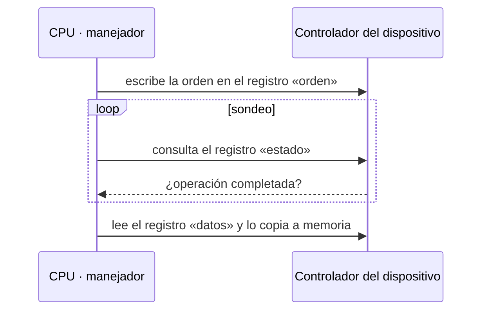
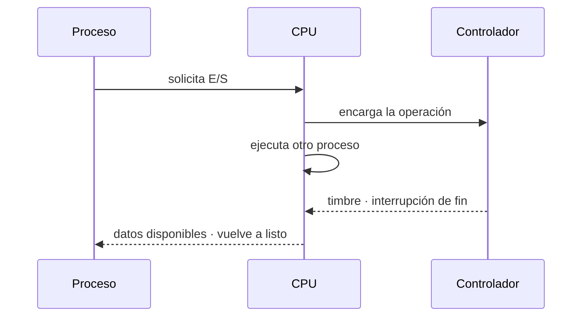
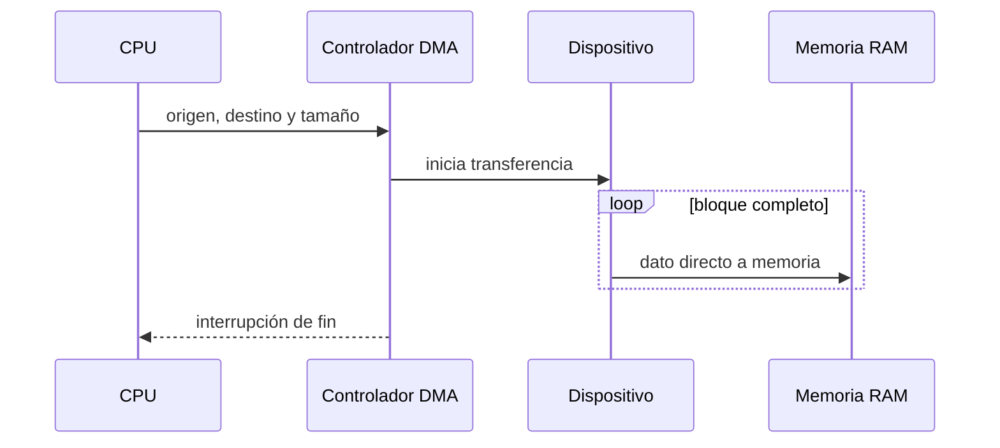
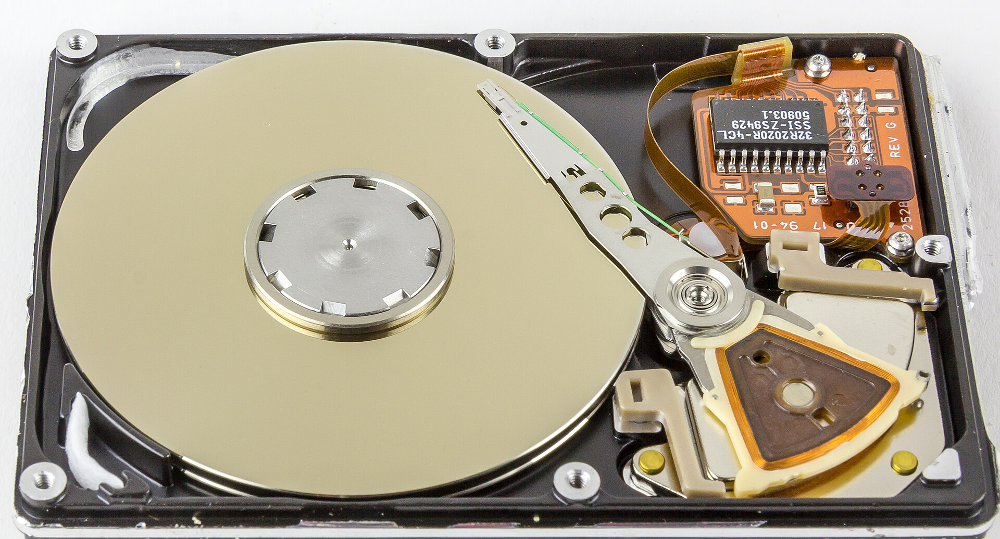

# Dispositivos de Entrada/Salida

## Dispositivos de un PC

Los dispositivos de E/S se pueden clasificar según con quién se comunican:

| Tipo | Ejemplos | Sentido | Velocidad |
|------|----------|---------|-----------|
| **Interacción con personas** (HCI, *Human-Computer Interaction*) | teclado, ratón, micrófono, cámara (entrada); pantalla, altavoces, impresora (salida) | entrada **o** salida | lenta, al ritmo de una persona |
| **Almacenamiento** | disco duro (HDD), SSD, memoria USB | entrada **y** salida | rápida, por bloques |
| **Comunicación** | Ethernet, Wi-Fi, Bluetooth | entrada **y** salida | rápida, por paquetes |

## Dispositivo, controlador y manejador

Un dispositivo tiene una parte hardware (dispositivo y controlador) y otra software (manejador o driver):

- El **dispositivo** hardware: la parte mecánica o electrónica (platos y cabezales, teclas, sensor…).
- El **controlador** del dispositivo: la electrónica que lo gobierna. La CPU no habla con el dispositivo, sino con los **registros** de su controlador: **orden** (qué operación hacer), **estado** (ocupado, terminado, error) y **datos** (el dato leído o el que se va a escribir).
- El **manejador** (*driver*): el código del sistema operativo que sabe programar los registros de un controlador concreto.

La CPU accede a los registros del controlador de dos formas:

- **Puertos de E/S**: un espacio de direcciones aparte, con instrucciones privilegiadas propias (`in`/`out` en x86).
- **E/S mapeada en memoria**: los registros ocupan direcciones de memoria física y se leen y escriben con instrucciones normales (como el chip de vídeo de la Mega Drive en `0xC00000`, visto en [gestión de memoria](../gestion-de-memoria/#mapeo-de-ficheros-mmap)). Esas páginas se marcan **sin caché** (bit de desactivación de caché de la [tabla de páginas](../gestion-de-memoria/#bits-de-la-tabla-de-páginas)): si no, la CPU leería una copia antigua del registro de estado.

### Dispositivos de bloque y de carácter

- **Bloque**: transfieren bloques de tamaño fijo (p. ej. 4096 bytes) y son **direccionables**: se puede leer o escribir cualquier bloque tras posicionarse. Discos duros, SSD, memorias USB.
- **Carácter**: producen o consumen un flujo de bytes **sin direcciones**. Teclado, ratón, puerto serie, terminal.

### Velocidades

| Dispositivo | Velocidad aproximada |
|-------------|----------------------|
| Teclado | 10 B/s |
| Ratón | 100 B/s |
| Disco duro (HDD) | 200 MB/s |
| SSD SATA | 550 MB/s |
| Red Ethernet de 10 Gb/s | 1,25 GB/s |
| SSD NVMe | 7 GB/s |

Entre el teclado y un SSD NVMe hay casi **nueve órdenes de magnitud**: ninguna técnica de E/S sirve igual de bien para todos.

### Buses e interfaces

Los controladores se conectan a la CPU y a la memoria a través de un **bus**. Los más comunes en un PC:

| Interfaz | Qué conecta | Velocidad aproximada |
|----------|-------------|----------------------|
| **PCIe** | tarjeta gráfica, SSD NVMe, tarjeta de red | unos 2 GB/s por carril (PCIe 4.0); x4 en un SSD NVMe, x16 en una gráfica |
| **SATA** | discos duros, SSD SATA, lectores ópticos | 600 MB/s |
| **USB** | casi todo lo externo: teclado, ratón, memorias, cámaras | de 480 Mb/s (USB 2.0) a 40 Gb/s (USB4) |
| Antiguas | IDE o PATA (discos), PCI y AGP (tarjetas), PS/2 (teclado y ratón), puerto serie y paralelo | |

- **M.2** es un formato de conector, no un protocolo: un SSD M.2 puede ir por SATA o por NVMe (PCIe).
- El `i8042` de `/proc/interrupts` (más abajo) es el controlador PS/2: el teclado de los portátiles sigue conectado así.

`lspci` lista los controladores conectados por PCIe y `lsusb`, los dispositivos USB (salidas recortadas):

```text
$ lspci
00:02.0 VGA compatible controller: Intel Corporation Alder Lake-P GT2 [Iris Xe Graphics] (rev 0c)
00:14.0 USB controller: Intel Corporation Alder Lake PCH USB 3.2 xHCI Host Controller (rev 01)
00:14.3 Network controller: Intel Corporation Alder Lake-P PCH CNVi WiFi (rev 01)
00:17.0 SATA controller: Intel Corporation Alder Lake-P SATA AHCI Controller (rev 01)
01:00.0 Non-Volatile memory controller: Samsung Electronics Co Ltd NVMe SSD Controller PM9A1/PM9A3/980PRO
$ lsusb
Bus 001 Device 001: ID 1d6b:0002 Linux Foundation 2.0 root hub
Bus 001 Device 002: ID 046d:c31c Logitech, Inc. Keyboard K120
Bus 001 Device 003: ID 046d:c077 Logitech, Inc. M105 Optical Mouse
Bus 002 Device 002: ID 0781:5581 SanDisk Corp. Ultra
```

## Comunicación entre la CPU y el controlador

- ¿**Cómo sabe la CPU** que el dispositivo ha terminado la operación? Preguntándole una y otra vez (**sondeo**) o esperando a que él avise (**interrupción**).
- ¿**Quién copia los datos** entre el controlador y la memoria? La propia CPU (**E/S programada**) o un controlador de **DMA**.

### Sondeo

La CPU escribe la orden en el controlador y consulta el registro de estado en un bucle hasta que la operación termina (*polling*). Es **espera activa**, como la de [concurrencia y sincronización](../concurrencia-y-sincronizacion/#espera-activa-frente-a-bloqueo):



**Problema**: mientras espera, la CPU no hace nada útil. Al esperar una pulsación del teclado pasaría casi todo el tiempo dando vueltas en el bucle.

### Interrupciones

La CPU programa el controlador y se dedica a otra cosa (ejecutar instrucciones de otro proceso). Cuando el controlador termina, activa una **interrupción**: la CPU suspende lo que estaba haciendo y ejecuta la **rutina de servicio** del manejador, que copia el dato y puede despertar al proceso que lo esperaba. Es la **E/S dirigida por interrupciones**.



- Cómo guarda la CPU el contexto y salta a la rutina de la interrupción se ve en [espacio de usuario y espacio de kernel](../espacio-usuario-espacio-kernel/).
- Para saber **qué dispositivo** ha interrumpido, cada uno tiene un número (IRQ) que indexa una tabla con la dirección de su rutina: **interrupciones vectorizadas**. Sin esa tabla, el gestor de interrupciones tendría que preguntar (sondear) a cada controlador quién ha terminado y producido la interrupción.

**Problema**: la CPU sigue copiando los datos uno a uno, con una interrupción por dato. Vale para un teclado, pero un disco generaría millones de interrupciones por segundo.

### DMA

Un controlador de **DMA** (*Direct Memory Access*, acceso directo a memoria) copia el bloque completo entre el dispositivo y la memoria sin pasar por la CPU. La CPU solo indica origen, destino y tamaño, y recibe **una interrupción al final** del bloque, no una por dato suelto. Mientras tanto sigue ejecutando otros procesos. El DMA y la CPU comparten la memoria: si los dos la usan a la vez, uno espera (**robo de ciclos**). Hoy se nota poco, porque la CPU trabaja casi siempre con su caché.



### Resumen

| | Aviso por **sondeo** | Aviso por **interrupción** |
|---|---|---|
| **Copia la CPU** (E/S programada) | Lo más simple; la CPU queda ocupada esperando. Microcontroladores sencillos. | Una interrupción por dato. Teclado, ratón. |
| **Copia el DMA** | Dispositivos muy rápidos: SSD NVMe, red con mucho tráfico. | Una interrupción por bloque. Discos, red. |

### ¿Cuándo compensa el sondeo?

Atender una interrupción no es gratis: hay que guardar el contexto, ejecutar la rutina de servicio, y el proceso despertado aún tiene que esperar su turno en la cola de listos. En total, unos pocos microsegundos.

- **Dispositivo lento** comparado con ese coste (teclado: cientos de milisegundos entre pulsaciones; disco duro: milisegundos): las interrupciones ganan de lejos, sondear sería desperdiciar casi toda la CPU.
- **Dispositivo muy rápido** (SSD NVMe: unos 10 µs por lectura; red de 100 Gb/s: millones de paquetes por segundo): el coste de atender la interrupción (unos µs) es parecido a lo que tarda el propio dispositivo en leer el bloque o recibir el paquete, y **sondear vuelve a compensar**.
- **Mixto** (lo que hace Linux con la red): el primer paquete llega con una interrupción; el manejador desactiva las interrupciones de la tarjeta y sondea mientras sigan llegando paquetes; cuando la cola se vacía, las vuelve a activar. Con poco tráfico funciona como interrupciones y con mucho, como sondeo.
- **Agrupación de interrupciones** (*interrupt coalescing*): el controlador espera a tener varias operaciones terminadas (o a que pase un tiempo máximo) y avisa de todas con una sola interrupción.

`/proc/interrupts` muestra cuántas interrupciones ha atendido cada CPU en cada línea (IRQ) y qué manejador la usa (salida recortada):

```text
$ cat /proc/interrupts
            CPU0       CPU1       CPU2       CPU3
   1:          0          0       2158          0  IR-IO-APIC    1-edge       i8042
 125:          0     184342          0          0  IR-PCI-MSI    327680-edge  xhci_hcd
 127:      51236          0          0          0  IR-PCI-MSI    1048577-edge nvme0q1
 128:          0      48877          0          0  IR-PCI-MSI    1048578-edge nvme0q2
 129:          0          0      50310          0  IR-PCI-MSI    1048579-edge nvme0q3
 130:          0          0          0      47702  IR-PCI-MSI    1048580-edge nvme0q4
 LOC:    4523109    4187322    4398001    4012877  Local timer interrupts
```

Con `watch -n 1 cat /proc/interrupts`, al teclear o mover el ratón sube el contador de `i8042` (teclado de portátil) o de `xhci_hcd` (controlador USB). `LOC` son las interrupciones del reloj de cada CPU, que usa el planificador.

### En UNIX, todo es un fichero

- Cada dispositivo aparece como un **fichero especial** en `/dev`: se abre, se lee y se escribe con las mismas llamadas que un fichero normal. También hay dispositivos sin hardware detrás, como `/dev/null` o `/dev/urandom` (ver [pipes y fifos](../ipc-pipes-y-fifos/)).
- Cada fichero de dispositivo tiene:
  - **clase**: de bloque (`b`) o de carácter (`c`).
  - **número mayor** (*major number*): identifica el manejador, es decir, la familia de dispositivos.
  - **número menor** (*minor number*): se le pasa al manejador para distinguir entre varios dispositivos semejantes (cada disco, cada partición, cada terminal).

```text
$ ls -l /dev/null /dev/nvme0n1 /dev/sda /dev/sda1 /dev/tty1
crw-rw-rw- 1 root root   1, 3 Oct 23 09:12 /dev/null
brw-rw---- 1 root disk 259, 0 Oct 23 09:12 /dev/nvme0n1
brw-rw---- 1 root disk   8, 0 Oct 23 09:12 /dev/sda
brw-rw---- 1 root disk   8, 1 Oct 23 09:12 /dev/sda1
crw--w---- 1 root tty    4, 1 Oct 23 09:12 /dev/tty1
```

La primera letra es la clase, y donde un fichero normal muestra el tamaño aparecen `mayor, menor`. `/proc/devices` relaciona cada número mayor con su manejador (salida recortada):

```text
$ cat /proc/devices
Character devices:
  1 mem
  4 tty
Block devices:
  8 sd
259 blkext
```

## La E/S vista desde el proceso

Todo lo anterior ocurre dentro del kernel: el proceso no ve interrupciones ni DMA, solo llamadas al sistema. Lo que sí elige es **qué hace mientras espera** a que acabe la E/S:

| Modo | `read()` sin datos disponibles | Mientras tanto, el proceso… | Cómo |
|------|--------------------------------|-----------------------------|------|
| **Bloqueante** | espera | pasa a **en espera** y la CPU ejecuta otro proceso | por defecto |
| **No bloqueante** | devuelve `-1` con `errno = EAGAIN` | sigue y lo vuelve a intentar más tarde | `O_NONBLOCK` |
| **Multiplexada** | espera a **varios** descriptores a la vez | despierta en cuanto uno tiene datos | `select` |
| **Asíncrona** | la operación queda en marcha | sigue trabajando y luego comprueba si ha terminado | `aio_read`, `io_uring` |

- **Bloqueante** es lo normal y lo más sencillo de programar. Cuando la interrupción indica que la operación ha terminado, el proceso pasa a **listo**. La CPU y el dispositivo trabajan a la vez, pero **para procesos distintos**: mientras uno espera al disco, otro calcula.
- **No bloqueante** es sondeo, pero a nivel de proceso: si se reintenta en un bucle, gasta CPU igual que la espera activa. `O_NONBLOCK` y `select` se ven en [pipes y fifos](../ipc-pipes-y-fifos/) (apartado opcional).
- **Multiplexada**: `select` bloquea hasta que alguno de varios descriptores tiene datos; así un proceso atiende varias pipes a la vez sin sondearlas.
- **Asíncrona**: el proceso pide la operación («lee estos datos en este búfer») y la llamada vuelve enseguida. La operación sigue en marcha por su cuenta (el kernel con DMA) mientras el proceso hace otras operaciones, y más tarde el comprueba si el búfer ya está lleno o recibe un aviso. A diferencia de la no bloqueante, no hay que repetir la llamada: la operación avanza sola. `aio_read` es la interfaz POSIX e `io_uring` la más reciente de Linux.

### Búferes

Un **búfer** es una zona de memoria donde se acumulan datos entre el dispositivo y el proceso, para que ninguno tenga que esperar al otro en cada dato:

- **Búfer de entrada**: guarda lo que llega antes de que el proceso lo pida, como las teclas pulsadas o los paquetes de red, hasta que hace `read()`.
- **Búfer de salida**: `write()` copia los datos al búfer y vuelve; el sistema operativo los envía después al dispositivo, a su ritmo (impresora, red).
- Hay búferes **hardware**, en el controlador, y **software**, en el kernel.
- **Doble búfer**: con dos búferes que se alternan, mientras el dispositivo llena uno el proceso vacía el otro.
- En gráficos, el doble búfer es muy común: el programa dibuja la imagen siguiente en un búfer mientras la pantalla muestra el otro, y al terminar se intercambian; así nunca se ve una imagen a medio dibujar. Con **triple búfer**, la tarjeta gráfica puede empezar la imagen siguiente en un tercer búfer sin esperar a que la pantalla haga el cambio.


***Spooling***: un dispositivo que no se puede compartir, como una impresora, no se asigna a ningún proceso. Cada trabajo se guarda en una cola en disco y un proceso del sistema los envía al dispositivo de uno en uno.

**Búfer frente a caché**: un búfer puede guardar la única copia de un dato mientras va del dispositivo al proceso o al revés; una caché guarda una copia de un dato que también está en otro sitio, para no tener que ir a buscarlo.

Tener copias tiene un precio: si el original cambia, la copia de la caché queda **obsoleta**, y hay que saber cuándo invalidarla (**coherencia**). De ahí la frase de Phil Karlton: «En informática solo hay dos cosas difíciles: invalidar cachés y poner nombres a las cosas». En esta asignatura no se estudian los protocolos de coherencia de cachés.


## Discos

| Tipo | Cómo funciona | Ventajas | Inconvenientes |
|------|---------------|----------|----------------|
| **HDD** (*Hard Disk Drive*) | Platos magnéticos que giran y cabezales en un brazo móvil | Barato por GB, gran capacidad | Lento en accesos aleatorios (milisegundos), frágil |
| **SSD** (*Solid State Drive*) | Chips de memoria flash, sin partes móviles | Rápido (microsegundos), silencioso, poco consumo | Más caro por GB; cada celda aguanta un número limitado de escrituras |

Los SSD se conectan por **SATA**, como los discos duros, o por **NVMe**, directamente al bus PCIe y mucho más rápido (ver [buses e interfaces](#buses-e-interfaces)).

`lsblk` lista los discos; la columna `ROTA` indica si son rotacionales (1 = HDD, 0 = SSD):

```text
$ lsblk -d -o NAME,ROTA,SIZE,TYPE
NAME    ROTA   SIZE TYPE
sda        1   1.8T disk
nvme0n1    0 476.9G disk
```

### Disco duro: el tiempo se va en mover piezas



<sub>Fuente: © Raimond Spekking / CC BY-SA 4.0, vía Wikimedia Commons. [Ficha y licencia](https://commons.wikimedia.org/wiki/File:Seagate_ST9300AG_-_opened._Platter_and_head_mechanics-9324.jpg).</sub>

```text
t_acceso = t_búsqueda + t_rotación + t_transferencia
```

- **Búsqueda**: mover el brazo hasta la pista (4–10 ms).
- **Rotación**: esperar a que el sector pase bajo el cabezal (a 7200 rpm, media vuelta son unos 4 ms).
- **Transferencia**: leer los datos (4 KB a 200 MB/s, unos 0,02 ms).

En un acceso aleatorio casi todo el tiempo es mecánico: leer bloques seguidos es cientos de veces más rápido que saltar de uno a otro. Por eso el sistema operativo **reordena las peticiones** pendientes para que el brazo se mueva lo menos posible: por ejemplo, el algoritmo **SCAN** las atiende en el orden en que el brazo pasa por ellas, como un ascensor.

### SSD: lo que cambia

- **No hay brazo ni giro**: cualquier bloque tarda lo mismo (10–100 µs), así que reordenar peticiones apenas aporta. Linux no usa planificador para los NVMe (entre corchetes, el activo; en un disco duro suele ser `mq-deadline` o `bfq`):

```text
$ cat /sys/block/nvme0n1/queue/scheduler
[none] mq-deadline kyber bfq
$ cat /sys/block/sda/queue/scheduler
none [mq-deadline] kyber bfq
```

- **No se puede sobrescribir en el sitio**: la memoria flash hay que **borrarla por bloques grandes** (cientos de KB) antes de volver a escribir, y cada bloque aguanta un número limitado de borrados. El propio controlador del SSD lo oculta: traduce los bloques lógicos a físicos y reparte las escrituras para que todas las celdas se gasten por igual (**nivelación del desgaste**, *wear leveling*).
- **TRIM**: al borrar un fichero, el sistema de ficheros avisa al SSD de qué bloques ya no se usan, para que pueda borrarlos con antelación y no los copie inútilmente. En Linux lo hace `fstrim` (normalmente una vez por semana) o la opción de montaje `discard`.

## Otros dispositivos en Linux

| Dispositivo | Fichero en `/dev` | Clase | Subsistema | Qué se lee o escribe |
|-------------|-------------------|-------|------------|----------------------|
| Teclado y ratón | `/dev/input/event0`, `event1`… | carácter | *input* | eventos: tipo, código (qué tecla o eje) y valor |
| Pantalla | `/dev/fb0` (antiguo), `/dev/dri/card0` | carácter | *framebuffer*, DRM/KMS | los píxeles de la imagen (`fb0`) u órdenes para la tarjeta gráfica (`card0`) |
| Tarjeta de sonido | `/dev/snd/pcmC0D0p`, `/dev/snd/controlC0` | carácter | ALSA | muestras de audio (`pcm`) o volumen y ajustes (`control`) |

### Teclado y ratón

- Cada pulsación o movimiento es un evento (una estructura `input_event`) que se lee con `read()`; si no hay ninguno, el proceso se bloquea hasta el siguiente. Para una tecla, el valor es 1 al pulsarla, 0 al soltarla y 2 si se repite por mantenerla pulsada. `evtest` los muestra.
- Solo `root` (o el grupo `input`) puede leerlos: quien los lea ve todo lo que se teclea, contraseñas incluidas.

### Pantalla

- `/dev/fb0` representa la memoria de la imagen: se puede [mapear con `mmap`](../gestion-de-memoria/#mapeo-de-ficheros-mmap) y pintar escribiendo píxeles en un array. Desde una consola de texto y como `root`, `cat /dev/urandom > /dev/fb0` llena la pantalla de ruido.
- Los entornos gráficos actuales usan `/dev/dri/card0`: con él el kernel fija la resolución (KMS) y reparte la tarjeta gráfica entre los programas (DRM). El intercambio del [doble búfer](#búferes) se hace cuando la pantalla termina de mostrar una imagen, para no verla a medias.

### Sonido

- `pcmC0D0p` es la salida (*playback*) del dispositivo 0 de la tarjeta 0; la entrada (*capture*, el micrófono) termina en `c`.
- La tarjeta lee las muestras **por DMA** de un **búfer circular** en memoria y lanza una interrupción cada **periodo** (un trozo del búfer), para que se rellene lo ya reproducido. Si el proceso no lo rellena a tiempo, la tarjeta se queda sin datos y se oye un chasquido (*underrun*).
- El dispositivo `pcm` de una tarjeta solo lo puede tener abierto un programa a la vez. Por eso lo abre un **servidor de sonido** (PipeWire o PulseAudio), que mezcla el audio de todos los programas y lo envía a la tarjeta, parecido al *spooling*. `aplay -l` lista las tarjetas.
