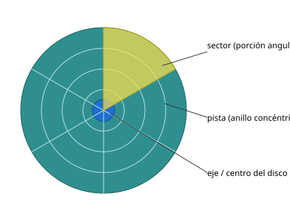
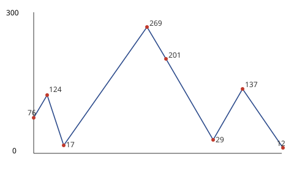
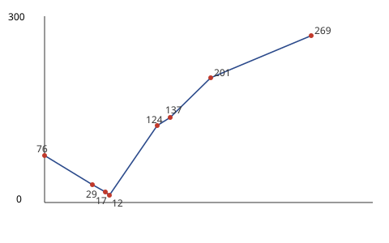
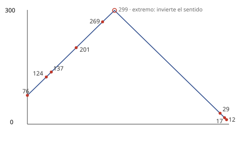

# Dispositivos de Entrada/Salida: material adicional

## Modelo de tiempos: sondeo frente a interrupciones

| Componente | Significado |
|-----------|-------------|
| `tiempo_cómputo` | tiempo invertido en el cómputo |
| `tiempo_dispositivo` | tiempo invertido en las operaciones de E/S |
| `tiempo_sobrecarga` | tiempo que el proceso invierte en determinar cuándo se completa cada operación de E/S |
| `tiempo_sondeo` | tiempo que el proceso invierte en determinar la finalización de la E/S **con sondeo** |
| `tiempo_manejador` | tiempo acumulado en ejecutar el manejador de interrupciones y las rutinas de manejo del dispositivo |
| `tiempo_listo` | tiempo que el proceso acumula esperando para usar la CPU al concluir la E/S |

```text
tiempo_total = tiempo_cómputo + tiempo_dispositivo + tiempo_sobrecarga

E/S con sondeo:          tiempo_sobrecarga = tiempo_sondeo
E/S con interrupciones:  tiempo_sobrecarga = tiempo_manejador + tiempo_listo
```

Con dispositivos lentos respecto al coste de una interrupción, `tiempo_sondeo > tiempo_manejador + tiempo_listo` y las interrupciones salen a cuenta. Con dispositivos muy rápidos (SSD NVMe, red de alta velocidad) puede ocurrir lo contrario, y por eso se vuelve a sondear.

Con varios hilos de ejecución y solapamiento mediante interrupciones, el `tiempo_total` deja de ser la suma de los `tiempo_total` individuales: mientras un hilo hace E/S (`tiempo_dispositivo`), otro computa (`tiempo_cómputo`). Al emplear interrupciones se aprovecha mejor la CPU y se reduce el tiempo total del conjunto de procesos.

## Tipos de discos y conexiones

| Tipo | Descripción |
|------|-------------|
| **HDD** (*Hard Disk Drive*), discos magnéticos | Dispositivos mecánicos de superficies giratorias; gran capacidad a coste reducido, pero más lentos y frágiles. |
| **SSD** (*Solid State Drive*), estado sólido | Usan chips de memoria flash; más rápidos, silenciosos y de menor consumo, pero más caros por GB y con un número limitado de escrituras por celda. |
| **SSHD**, híbridos | Un disco magnético con algo de memoria flash dedicada a los datos de acceso más frecuente; sus prestaciones dependen de la cantidad de flash. |

**Tipos de conexión**: **SATA** (discos internos, HDD o SSD) · **NVMe** (protocolo para SSD conectados directamente al bus PCIe de la placa base) · **USB** (discos externos) · **tarjetas SD**.

## Geometría del disco

- Un disco magnético tiene varios **platos**, cada uno con una o dos **superficies** de almacenamiento.
- Cada superficie se divide en **pistas** (anillos concéntricos) y en **sectores** (porciones angulares del círculo). La intersección de una pista con un sector es el **sector de pista**, la unidad mínima que se lee o escribe.
- Hay un cabezal por superficie; todos van unidos al **mismo brazo** y se mueven a la vez (un único motor). Las pistas que quedan bajo los cabezales en una posición del brazo forman un **cilindro**: se accede a ellas **sin mover el brazo**.
- Para leer o escribir, el disco debe estar **girando**, el brazo debe **llevar el cabezal a la pista** y hay que **esperar a que pase el sector**.
- La capacidad del disco es superficies × pistas × sectores por pista × bytes por sector.



Los discos actuales meten más sectores en las pistas exteriores, que son más largas (grabación por zonas), así que la geometría real ya no coincide con este modelo. El controlador la oculta y presenta el disco como una lista lineal de bloques numerados (LBA, *Logical Block Addressing*).

## Algoritmos de planificación de disco

El manejador mantiene una **cola de peticiones** pendientes y el planificador decide en qué orden atenderlas para reducir el movimiento del brazo.

Para todos los ejemplos: disco con pistas de la 0 a la 299, cola de **peticiones 76, 124, 17, 269, 201, 29, 137, 12** y cabeza inicialmente en la pista **76**, subiendo.

### FCFS (*first come, first served*)

Las peticiones se atienden en **orden de llegada**. Es justo, pero el brazo va de un lado a otro. Recorrido total: **880** pistas.



### SSTF (*shortest seek time first*)

Se atiende siempre la petición **más cercana** a la posición actual. Reduce mucho el recorrido, pero puede producir **inanición** (*starvation*): si siguen llegando peticiones cerca de la cabeza, una lejana puede no atenderse nunca. Orden de servicio: `76 → 29 → 17 → 12 → 124 → 137 → 201 → 269`. Recorrido total: **321** pistas.



### SCAN (barrido) y LOOK

- **SCAN**: la cabeza avanza en un sentido atendiendo las peticiones que encuentra hasta llegar al **extremo del disco**; entonces invierte el sentido. Funciona como un **ascensor**. Recorrido total: **510** pistas.
- **LOOK**: igual, pero invierte el sentido en la **última petición pendiente**, sin llegar al extremo. Recorrido total: **450** pistas.



*SCAN atiende las peticiones mientras la cabeza avanza en un sentido, como un ascensor que no cambia de dirección hasta llegar al final.*

### C‑SCAN y C‑LOOK (circulares)

Solo atienden peticiones en **un sentido**: al llegar al final, la cabeza vuelve al principio sin atender nada y empieza otro barrido. Recorren más pistas, pero el tiempo de espera es más **uniforme**: con SCAN, las pistas centrales se visitan en los dos sentidos y las de los extremos esperan más.

### Comparativa

| Algoritmo | Orden de servicio | Recorrido |
|-----------|-------------------|-----------|
| FCFS | 76 → 124 → 17 → 269 → 201 → 29 → 137 → 12 | 880 |
| SSTF | 76 → 29 → 17 → 12 → 124 → 137 → 201 → 269 | 321 |
| SCAN | 76 → 124 → 137 → 201 → 269 → *299* → 29 → 17 → 12 | 510 |
| LOOK | 76 → 124 → 137 → 201 → 269 → 29 → 17 → 12 | 450 |
| C‑SCAN | 76 → 124 → 137 → 201 → 269 → *299* ⇢ *0* → 12 → 17 → 29 | 551 |
| C‑LOOK | 76 → 124 → 137 → 201 → 269 ⇢ 12 → 17 → 29 | 467 |

En cursiva, las posiciones a las que llega la cabeza sin atender ninguna petición; ⇢ es el retorno sin atender peticiones, que también cuenta en el recorrido.

Los planificadores actuales de Linux combinan estas ideas con **plazos** para evitar la inanición: `mq-deadline` ordena las peticiones por posición, pero atiende antes cualquiera que lleve demasiado tiempo esperando; `bfq` reparte el ancho de banda del disco entre procesos. Con SSD NVMe no se usa ninguno (`none`).
