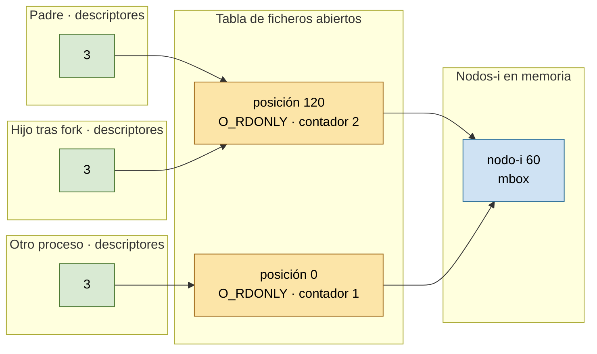
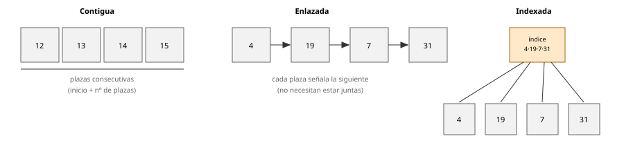
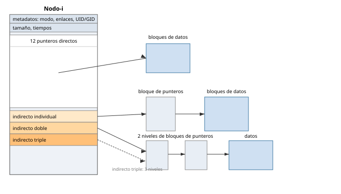
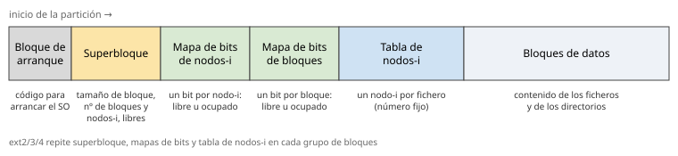
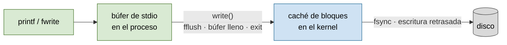
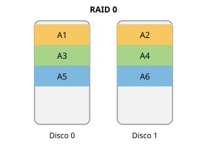
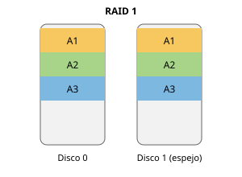
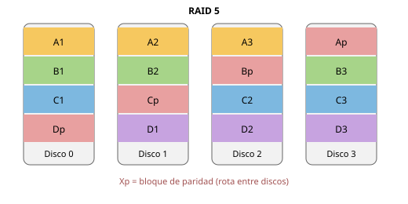
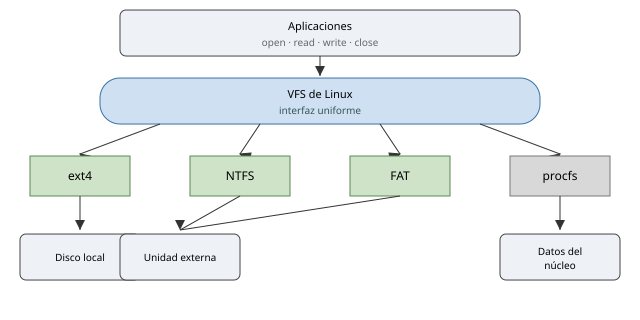

# Sistemas de ficheros

## Ficheros y directorios

- Para el **usuario**, un fichero es un conjunto de datos con nombre que se conserva aunque se apague el ordenador.
- Para el **sistema operativo**, es un **tipo abstracto de datos** al que los procesos acceden con **llamadas al sistema**. El sistema de ficheros oculta los detalles del dispositivo (dónde está cada bloque, cómo se lee) y añade lo que el hardware no da: **nombres**, **protección** y **compartición**.

### Tipos de fichero

La primera letra de `ls -l` indica el tipo:

| Letra | Tipo | Ejemplo |
|-------|------|---------|
| `-` | fichero regular | `notas.txt`, `/usr/bin/ls` |
| `d` | directorio | `/home` |
| `l` | enlace simbólico | `/bin → usr/bin` |
| `c` | dispositivo de carácter | `/dev/tty1`, `/dev/null` |
| `b` | dispositivo de bloque | `/dev/sda` |
| `p` | FIFO (pipe con nombre) | creada con `mkfifo` |
| `s` | socket local | `/run/systemd/notify` |

Los dispositivos se ven en [dispositivos de E/S](../dispositivos-de-es/) y las FIFO en [pipes y fifos](../ipc-pipes-y-fifos/).

### Directorios y rutas

- Un **directorio** es un fichero especial que guarda una lista de nombres.
- Los directorios forman un **árbol** cuya raíz es `/`.
- Una ruta **absoluta** empieza en la raíz (`/home/ana/notas.txt`); una **relativa** empieza en el **directorio de trabajo** del proceso (`notas.txt`, `../ana/notas.txt`).
- Todo directorio contiene `.` (él mismo) y `..` (su directorio padre).

Directorios estándar en Linux:

| Directorio | Contenido |
|------------|-----------|
| `/etc` | configuración del sistema |
| `/home` | directorios personales de los usuarios |
| `/usr` (`/usr/bin`, `/usr/lib`) | programas y bibliotecas instalados |
| `/var` | datos que cambian: registros (`/var/log`), colas, cachés |
| `/tmp` | ficheros temporales |
| `/dev` | ficheros de dispositivo |
| `/proc`, `/sys` | información del kernel y de los procesos |
| `/boot` | kernel y ficheros de arranque |
| `/mnt`, `/media` | puntos de montaje |

### Particiones y montaje

- Un disco se divide en **particiones**, rangos contiguos de bloques descritos en una tabla al principio del disco (**GPT**, o **MBR** en los antiguos). Cada partición lleva su propio sistema de ficheros.
- `lsblk` muestra los discos y sus particiones en árbol, con el tamaño y el punto de montaje de cada una:
  ```text
  $ lsblk
  NAME   MAJ:MIN RM   SIZE RO TYPE MOUNTPOINTS
  sda      8:0    0 476.9G  0 disk
  ├─sda1   8:1    0   512M  0 part /boot/efi
  └─sda2   8:2    0 476.4G  0 part /
  ```
- Aunque haya varios discos y particiones, el usuario ve **un único árbol**: cada sistema de ficheros se **monta** sobre un directorio del árbol, su **punto de montaje**.
- `mount /dev/sda1 /mnt` monta y `umount /mnt` desmonta; En `/etc/fstab` se indica qué se monta al arrancar. Antes de extraer un disco hay que desmontarlo, para que se escriba lo que quede en la [caché](#caché-de-bloques).
- `df -h` muestra los sistemas de ficheros montados, su punto de montaje y su espacio libre.

## Usar ficheros desde un programa

Las llamadas al sistema para trabajar con ficheros (`open`, `read`, `write`, `lseek`, `close`…) se practican en [entrada y salida: consola, ficheros, file descriptors](../../PRACTICA/entrada-salida-y-ficheros/).

### Acceso secuencial y directo

- **Secuencial**: se lee o escribe en orden; cada `read` o `write` empieza donde acabó el anterior. Es lo habitual: copiar un fichero, reproducir un vídeo.
- **Directo** (o aleatorio): se salta a cualquier posición con `lseek` y se lee o escribe allí sin pasar por lo anterior. Lo usan, por ejemplo, las bases de datos, un reproductor al saltar al minuto 30 de un vídeo o un cliente BitTorrent, que escribe cada trozo en su sitio según le llega.

Cuánto tiempo cuesta cada uno depende de cómo esté guardado el fichero en el disco (ver [asignación de bloques](#asignación-de-bloques)).

### Tablas de ficheros abiertos

Un descriptor es solo un número; detrás hay tres tablas en el kernel:

- **Tabla de descriptores**, una por proceso: el descriptor es un índice en ella. Las entradas 0, 1 y 2 son `stdin`, `stdout` y `stderr`, que pueden apuntar a un terminal, a un fichero o a una pipe.
- **Tabla de ficheros abiertos** una para todo el sistema: una entrada por cada `open`, con la **posición** actual, el **modo** de apertura y un **contador** de cuántos descriptores la usan.
- **Tabla de nodos‑i en memoria**, una para todo el sistema: una copia de los metadatos de cada fichero en uso, aunque lo hayan abierto varios procesos.



*Padre e hijo comparten la entrada de la tabla de ficheros abiertos (y la posición); otro proceso que abre el mismo fichero tiene su propia entrada.*

- Tras `fork`, el hijo copia la tabla de descriptores, pero sus entradas apuntan a las **mismas** entradas de la tabla de ficheros abiertos. El hijo seguirá leyendo de los ficheros desde donde el padre los dejó, y viceversa.
- Dos `open` del mismo fichero crean dos entradas distintas, cada una con su posición.
- `dup2(fd, 1)` hace que el descriptor 1 apunte a la misma entrada que `fd`: así redirige el shell la salida estándar.
- `close` resta uno al contador y la entrada solo se libera al llegar a 0. Por eso hay que cerrar los extremos de una pipe que no se usan (ver [pipes y fifos](../ipc-pipes-y-fifos/)).

<details> <summary> Ver los descriptores y su posición en /proc </summary>

`/proc/<pid>/fd` muestra los descriptores de un proceso (`self` es el propio proceso que lo consulta, aquí `ls`, que tiene abierto como 3 el directorio que está listando):

```text
$ ls -l /proc/self/fd
lrwx------ 1 alumno alumno 64 Oct 23 10:05 0 -> /dev/pts/0
lrwx------ 1 alumno alumno 64 Oct 23 10:05 1 -> /dev/pts/0
lrwx------ 1 alumno alumno 64 Oct 23 10:05 2 -> /dev/pts/0
lr-x------ 1 alumno alumno 64 Oct 23 10:05 3 -> /proc/12345/fd
```

`/proc/<pid>/fdinfo/<fd>` muestra la posición. Si el shell abre un fichero y un hijo lee por ese descriptor, la posición del shell avanza:

```text
$ exec 3< mbox                   # el shell abre mbox como descriptor 3
$ head -c 120 <&3 > /dev/null    # un hijo (head) lee 120 bytes por ese descriptor
$ cat /proc/$$/fdinfo/3          # $$ es el PID del shell (salida recortada)
pos:	120
flags:	0100000
```

</details>

### Bloqueo de ficheros

Si dos procesos leen, modifican y escriben a la vez el mismo fichero, hay una [condición de carrera](../concurrencia-y-sincronizacion/#exclusión-mutua). El fichero se protege con un **cerrojo** (*lock*):

- `flock(fd, LOCK_EX)`: cerrojo **exclusivo**, para escribir; solo puede tenerlo un proceso.
- `flock(fd, LOCK_SH)`: cerrojo **compartido**, para leer; pueden tenerlo varios procesos a la vez, pero nunca junto con uno exclusivo. Es el problema de los [lectores‑escritores](../concurrencia-y-sincronizacion/#patrones-de-concurrencia-comunes).
- `flock(fd, LOCK_UN)` lo suelta; también se suelta al cerrar el fichero o al terminar el proceso.
- Si el cerrojo está cogido, `flock` **bloquea** al proceso hasta que se libere.

```c
int fd = open("contador.txt", O_RDWR);
flock(fd, LOCK_EX);   /* espera si otro proceso tiene el cerrojo */
/* sección crítica: leer el contador, sumarle 1 y escribirlo */
flock(fd, LOCK_UN);
close(fd);
```

- En Linux los cerrojos son **consultivos** (*advisory*): solo protegen frente a procesos que también llaman a `flock`; uno que no lo haga puede escribir igualmente. Windows los aplica de forma **obligatoria** (*mandatory*): por eso no deja borrar un fichero abierto en otro programa.
- `fcntl` permite bloquear solo un **rango de bytes** (un registro), para que varios procesos modifiquen a la vez partes distintas del fichero. Lo usan bases de datos como SQLite.
- El comando `flock` hace lo mismo desde el shell: `flock /tmp/informe.lock ./informe.sh` coge el cerrojo de `/tmp/informe.lock` (un fichero vacío que solo sirve de cerrojo; se crea si no existe), ejecuta `./informe.sh` y lo suelta al acabar. Si se lanza la misma línea mientras la primera sigue en marcha, la segunda espera: nunca hay dos copias del script a la vez.

## Permisos

Cada fichero tiene un **propietario** (UID), un **grupo** (GID) y nueve bits de permisos: `r` (lectura), `w` (escritura) y `x` (ejecución) para el propietario, el grupo y el resto. Se escriben en octal, un dígito por terna (`r` = 4, `w` = 2, `x` = 1): `0764` es `rwxrw-r--`.

- **Cómo se comprueban**: el kernel compara el UID del proceso con el propietario. Si coincide, se aplica la terna del propietario; si no, y el proceso pertenece al grupo, la del grupo; si no, la de otros. Solo se aplica **una** terna: un propietario con `r--` no puede escribir aunque los otros tengan `rw-`. `root` se salta las comprobaciones.
- **En un directorio**, `r` permite listar los nombres, `w` crear, borrar y renombrar entradas, y `x` entrar en él (`cd`) o pasar por él en una ruta: para abrir `/home/ana/notas.txt` hace falta `x` en `/`, `/home` y `/home/ana`. Con `r` y sin `x` se ven los nombres pero no se puede abrir nada; con `x` y sin `r` se abre un fichero si se sabe su nombre, pero no se puede listar. Borrar un fichero depende de los permisos del **directorio**, no de los del fichero.
- **`umask`**: atributo de cada proceso, que heredan los hijos, con los permisos que se quitan al crear un fichero. Se cambia con la llamada `umask(022)` o con el comando del shell `umask 022`. Con 022, `open("f", O_CREAT | O_WRONLY, 0666)` crea el fichero con `0644`.
- Linux también admite **ACL** (listas de control de acceso, `getfacl` / `setfacl`) para dar permisos a usuarios concretos; Windows las usa siempre.

Los comandos (`ls -l`, `chmod`, `chown`) están en [shell y herramientas](../../PRACTICA/shell-y-herramientas/#permisos-de-ficheros).

<details> <summary> Bits especiales: setuid, setgid y sticky </summary>

- **setuid** (`s` en lugar de la `x` del propietario): el programa se ejecuta con el UID del **propietario** del fichero, no con el de quien lo lanza. `passwd` es de `root` y tiene setuid para poder modificar `/etc/shadow`: `-rwsr-xr-x`.
- **setgid**: igual, con el grupo. En un directorio, los ficheros nuevos heredan su grupo.
- **sticky** (`t` en lugar de la `x` de otros), en un directorio: solo el propietario de un fichero puede borrarlo, aunque todos tengan `w` en el directorio. Es lo que tiene `/tmp`: `drwxrwxrwt`.

</details>

## Cómo se guarda un fichero en el disco

### Traducción flujo‑bloque

El disco se ve como una lista de bloques numerados (ver [dispositivos de E/S](../dispositivos-de-es/)), y el fichero, como una secuencia de bytes. El sistema de ficheros traduce cada posición del fichero a un bloque del disco: con bloques de 4096 bytes, el byte 10 000 está en el bloque 2 del fichero (desplazamiento 1808), y la **asignación** del fichero dice qué bloque del disco es ese.


### Bloques y agrupaciones

- **Bloque**: unidad mínima que lee y escribe el sistema de ficheros; agrupa varios sectores del disco. Hoy suele ser de 4 KB y se elige al crear el sistema de ficheros (`mkfs -b`).
- **Agrupación** (*cluster*, en FAT y NTFS): varios bloques que se asignan juntos.
- Un fichero ocupa siempre bloques enteros: el espacio sobrante del último es **fragmentación interna**. Un fichero de 5 bytes ocupa 4 KB:

```text
$ echo hola > a.txt
$ ls -l a.txt
-rw-r--r-- 1 alumno alumno 5 Oct 23 10:00 a.txt
$ du -h a.txt
4.0K	a.txt
```

- **Bloque grande**: menos metadatos y menos saltos al leer ficheros grandes, pero más espacio perdido con archivos pequeños. **Bloque pequeño**: al revés.

### Asignación de bloques

| Método | Qué guarda el sistema de ficheros | Ventajas | Inconvenientes | Ejemplo |
|--------|-----------------------------------|----------|----------------|---------|
| **Contigua** | primer bloque y número de bloques | lectura secuencial y acceso directo rápidos | hay que saber el tamaño al crear; [fragmentación externa](../gestion-de-memoria/#fragmentación-externa-e-interna) y compactación | CD y DVD (ISO 9660) |
| **Enlazada** | primer bloque; cada bloque apunta al siguiente | sin fragmentación externa | acceso directo lento: hay que recorrer la cadena | FAT |
| **Indexada** | una tabla con todos los bloques del fichero | acceso directo rápido | la tabla ocupa sitio y puede quedarse corta (indirecciones) | nodo‑i (UNIX, ext2, ext3) |
| **Extents** | tramos contiguos: (bloque inicial, longitud) | pocos metadatos para ficheros grandes | empeora si el disco está muy fragmentado | ext4, NTFS, XFS, Btrfs |

Los **extents** son un punto intermedio entre la asignación contigua y la indexada: el fichero se guarda en uno o varios tramos de bloques contiguos y, en lugar de un puntero por bloque, se guarda un par (bloque inicial, longitud) por tramo. Un fichero en los bloques 100–199 y 500–549 se describe con dos extents, (100, 100) y (500, 50), en lugar de con 150 punteros. Si crece y los bloques siguientes están ocupados, se añade otro tramo donde haya sitio. Así, un fichero de 1 GB bien colocado se describe con unos pocos tramos, en lugar de con 262144 punteros.



**FAT** (*File Allocation Table*) es asignación enlazada, pero con los punteros fuera de los bloques de datos, en una tabla con una entrada por bloque del disco. La entrada de directorio guarda el primer bloque del fichero; la entrada de cada bloque en la FAT dice cuál es el siguiente bloque del fichero (o *fin*). El fichero de la figura, que empieza en el 4:

| Bloque | 4 | 7 | 19 | 31 |
|--------|---|---|----|----|
| FAT[bloque] (siguiente) | 19 | 31 | 7 | fin |

Como la tabla cabe en memoria, recorrer la cadena no exige leer los bloques de datos.

### Nodo‑i

El **nodo‑i** (*inode*) guarda todo lo que el sistema sabe de un fichero **salvo su nombre**:

- tipo y permisos (el «modo»), número de enlaces, UID y GID;
- tamaño;
- tiempos de último acceso (`atime`), última modificación del contenido (`mtime`) y último cambio del nodo‑i (`ctime`: permisos, enlaces…).
- punteros a los bloques: **directos** (10 en el UNIX clásico, 12 en ext2 y ext3) y un **indirecto simple**, un **indirecto doble** y un **indirecto triple**.



Tamaño máximo con bloques de 4 KB y punteros de 4 bytes (1024 punteros por bloque):

| Punteros | Bloques | Datos |
|----------|---------|-------|
| 12 directos | 12 | 48 KB |
| indirecto simple | 1024 | 4 MB |
| indirecto doble | 1024² | 4 GB |
| indirecto triple | 1024³ | 4 TB |

Los ficheros pequeños, que son la mayoría, solo usan punteros directos y no necesitan lecturas extra.

**Cuántas lecturas cuesta llegar a un byte.** El nodo‑i ya está en memoria desde el `open`. El bloque del fichero es el byte entre 4096 (división entera) y, según el puntero que le toque, antes del bloque de datos hay que leer los bloques de punteros (si no están en la caché):

| Byte | Bloque del fichero | Puntero (bloques que cubre) | Lecturas de disco |
|------|--------------------|-----------------------------|-------------------|
| 10 000 | 2 | directo (0–11) | 1: datos |
| 1 000 000 | 244 | indirecto simple (12–1035) | 2: indirecto simple y datos |
| 5 000 000 | 1220 | indirecto doble (1036–1 049 611) | 3: indirecto doble, indirecto simple y datos |

`stat` muestra el nodo‑i de un fichero:

```text
$ stat a.txt
  File: a.txt
  Size: 5          Blocks: 8          IO Block: 4096   regular file
Device: 259,2      Inode: 1835210     Links: 2
Access: (0644/-rw-r--r--)  Uid: ( 1000/  alumno)   Gid: ( 1000/  alumno)
Access: 2026-10-23 10:00:12.000000000 +0200
Modify: 2026-10-23 10:00:12.000000000 +0200
Change: 2026-10-23 10:00:31.000000000 +0200
 Birth: 2026-10-23 10:00:12.000000000 +0200
```

`Blocks` cuenta sectores de 512 bytes (8 = un bloque de 4 KB). ext4 sí guarda la creación (`Birth`).

### Directorios por dentro

Una entrada de directorio es solo un par **(número de nodo‑i, nombre)**: en el UNIX clásico, 2 bytes de nodo‑i y 14 de nombre; en ext4, entradas de longitud variable con nombres de hasta 255 bytes.

Para resolver una ruta, cada componente se busca en su directorio, lo que da el nodo‑i del siguiente. Por ejemplo, `/usr/ast/mbox`:

| Paso | Estructura | Contenido relevante | Resultado |
|------|-----------|---------------------|-----------|
| 1 | Directorio raíz (bloque de `/`) | `1 .` · `1 ..` · `4 bin` · `7 dev` · `14 lib` · `9 etc` · `6 usr` · `8 tmp` | la búsqueda de `usr` produce el **nodo‑i 6** |
| 2 | Nodo‑i 6 | modo · tamaño · tiempos · datos en el **bloque 132** | `/usr` está en el bloque 132 |
| 3 | Bloque 132 (directorio de `/usr`) | `6 .` · `1 ..` · `19 dick` · `30 erik` · `51 jim` · `26 ast` · `45 bal` | `/usr/ast` es el **nodo‑i 26** |
| 4 | Nodo‑i 26 | modo · tamaño · tiempos · datos en el **bloque 406** | `/usr/ast` está en el bloque 406 |
| 5 | Bloque 406 (directorio de `/usr/ast`) | `26 .` · `6 ..` · `64 grants` · `92 books` · `60 mbox` · `81 minix` · `17 src` | `/usr/ast/mbox` es el **nodo‑i 60** |

Cada paso puede ser una lectura de disco; por eso Linux guarda en memoria las últimas traducciones de nombre a nodo‑i.

### Enlaces duros y simbólicos

Como el nombre está en el directorio y no en el nodo‑i, un mismo fichero puede tener **varios nombres**:

- Un **enlace duro** (`ln a.txt b.txt`) es otra entrada de directorio con el **mismo número de nodo‑i**. El nodo‑i cuenta cuántos nombres tiene (`Links`); no hay un nombre «original».
- Un **enlace simbólico** (`ln -s a.txt c.txt`) es un fichero distinto cuyo contenido es una **ruta**. Si se borra el destino, el enlace queda roto.

```text
$ ln a.txt b.txt
$ ln -s a.txt c.txt
$ ls -li
total 8
1835210 -rw-r--r-- 2 alumno alumno 5 Oct 23 10:00 a.txt
1835210 -rw-r--r-- 2 alumno alumno 5 Oct 23 10:00 b.txt
1835214 lrwxrwxrwx 1 alumno alumno 5 Oct 23 10:00 c.txt -> a.txt
```

- `rm` en realidad hace `unlink`: borra un nombre y resta uno al contador de enlaces. El nodo‑i y sus bloques se liberan cuando el contador llega a 0 **y** ningún proceso tiene el fichero abierto. Un fichero borrado pero abierto sigue ocupando espacio (`df` lo cuenta, `du` no).
- Los enlaces duros no pueden cruzar sistemas de ficheros (cada uno numera sus nodos‑i) ni apuntar a directorios; los simbólicos sí.
- `.` y `..` son enlaces duros: por eso un directorio tiene 2 enlaces más uno por cada subdirectorio.

### Disposición en el disco

Un sistema de ficheros tipo UNIX reparte la partición en zonas fijas:



- **Superbloque**: describe el sistema de ficheros: tamaño de bloque, número de bloques y de nodos‑i, cuántos quedan libres, estado (limpio o no). Si se pierde, no se puede montar; por eso ext4 guarda copias.
- **Mapas de bits**: un bit por nodo‑i y otro por bloque, que indica si está libre u ocupado. Con ellos se encuentra espacio libre rápido, incluso bloques contiguos. La alternativa es una **lista enlazada de bloques libres**.
- **Tabla de nodos‑i**: su tamaño se fija al crear el sistema de ficheros, así que los nodos‑i **se pueden agotar** aunque quede espacio (con muchos ficheros pequeños):

```text
$ df -i /
Filesystem       Inodes  IUsed    IFree IUse% Mounted on
/dev/nvme0n1p2 31223936 612345 30611591    2% /
```

## Caché y fiabilidad

### Caché de bloques

Leer del disco es cientos o miles de veces más lento que leer de memoria, así que el kernel guarda en memoria los bloques usados recientemente. Al leer un bloque:

1. Si está en la **caché**, se usa la copia sin ir al disco.
2. Si no, se lee del disco y se guarda en la caché. Si está llena, se **reemplaza** un bloque, normalmente el que lleva más tiempo sin usarse (**LRU**). Si el bloque reemplazado se había modificado (**sucio**), antes se escribe en el disco.

En Linux, la caché usa toda la memoria que no necesitan los procesos (columna `buff/cache` de `free -h`) y es la misma que usa el [mapeo de ficheros con `mmap`](../gestion-de-memoria/#mapeo-de-ficheros-mmap).

**Políticas de escritura**:

| Política | Descripción | Compromiso |
|----------|-------------|-----------|
| **Escritura inmediata** (*write‑through*) | Se escribe en el disco cada vez que se modifica el bloque. | Fiable; lenta. |
| **Escritura diferida** (*write‑back*) | Solo se escribe cuando el bloque sale de la caché. | Rápida; si se va la luz se pierde lo no escrito. |
| **Escritura retrasada** (*delayed‑write*) | Los bloques modificados se escriben periódicamente (en Linux, al cabo de unos 30 s); los críticos, de inmediato. | Compromiso entre rendimiento y fiabilidad. Es lo que usan Linux y Windows. |

Por eso `write()` vuelve en cuanto el dato está en la caché, no en el disco. Si hace falta garantizarlo (una base de datos, un editor al guardar), `fsync(fd)` espera a que los bloques del fichero lleguen al disco; el comando `sync` lo hace con todos.

Un dato escrito con `printf` pasa por dos búferes antes de llegar al disco:



- `stdout` hacia un terminal se vacía además en cada `\n`.
- Si el proceso muere por una señal (`kill -9`) sin haber vaciado el búfer de `stdio`, lo que había en él se pierde.
- Lo que ya pasó por `write()` sobrevive aunque el proceso muera, pero no a un corte de luz mientras siga en la caché.

### Consistencia tras un fallo

Crear un fichero modifica varios bloques: el mapa de bits de nodos‑i, el nodo‑i, la entrada del directorio, el mapa de bits de bloques y los datos. Si se va la luz a mitad, el sistema de ficheros queda **inconsistente**: por ejemplo, un bloque marcado como ocupado que no es de nadie, o una entrada de directorio que apunta a un nodo‑i libre. Hay tres soluciones:

- **`fsck`**: al arrancar, recorre todo el sistema de ficheros y corrige las inconsistencias. En discos grandes puede tardar horas.
- **Journaling** (sistemas transaccionales): antes de modificar las estructuras, se escribe en un **diario** (*journal*) qué se va a hacer, como una transacción de una base de datos. Tras un fallo basta con repasar las últimas entradas del diario: las operaciones completas se rehacen y las incompletas se descartan. El sistema queda **consistente**, aunque se pierdan los últimos cambios. Lo usan ext3, ext4, XFS y NTFS.
- **Copia en escritura** (*copy‑on‑write*): nunca se sobrescribe un bloque en uso; la versión nueva se escribe en otro sitio y al final se cambia un único puntero de forma atómica. El sistema está siempre consistente y las **instantáneas** (*snapshots*) salen casi gratis: una instantánea es una copia del sistema de ficheros tal como estaba en un momento dado (para copias de seguridad o para volver atrás tras una actualización fallida), y basta con guardar el puntero raíz antiguo y no liberar sus bloques. A cambio, los ficheros que se modifican por partes (bases de datos, imágenes de máquinas virtuales) acaban fragmentados, y cada cambio obliga a reescribir también los metadatos que apuntan al bloque. Lo usan Btrfs, ZFS y APFS.

### RAID

Un **RAID** (*Redundant Array of Independent Disks*) combina varios discos que actúan como una única unidad, para mejorar el rendimiento, la tolerancia a fallos o ambas. Puede hacerse por hardware (una controladora) o por software (`mdadm` en Linux, o el propio Btrfs o ZFS).

**RAID 0** (*striping*): reparte los bloques entre los discos.



**RAID 1** (*mirroring*): duplica los datos en dos discos.



**RAID 5**: reparte los bloques y añade un bloque de **paridad** por fila, que va rotando entre los discos (`Xp` = bloque de paridad). La paridad es el XOR de los bloques de la fila: si falla un disco, cada bloque perdido se recalcula a partir de los demás.



| Nivel | Discos que pueden fallar | Capacidad útil | Notas |
|-------|--------------------------|----------------|-------|
| **RAID 0** | ninguno | toda | Lee y escribe más rápido; si falla un disco se pierde **todo**. |
| **RAID 1** | 1 | la mitad | Lee más rápido (de cualquiera de los dos); escribe como un solo disco. |
| **RAID 5** | 1 | todos menos uno | Mínimo 3 discos; las escrituras son costosas (hay que actualizar la paridad). |

**RAID no es una copia de seguridad**: protege frente a la avería de un disco, pero si se borra un fichero, o un virus lo cifra, el cambio se aplica a todos los discos a la vez.

### Copias de seguridad

| Copia | Qué copia | Para restaurar hace falta |
|-------|-----------|---------------------------|
| **Completa** | todo | esa copia |
| **Diferencial** | lo que ha cambiado desde la última completa | la completa y la última diferencial |
| **Incremental** | lo que ha cambiado desde la copia anterior, sea del tipo que sea | la completa y todas las incrementales posteriores |

- La incremental es la más rápida de hacer y la más lenta de restaurar; la diferencial crece cada día hasta la siguiente completa.
- Las instantáneas de Btrfs o ZFS no son copias: están en el mismo disco.
- **Regla 3‑2‑1**: tres copias de los datos, en dos soportes distintos, con una fuera del lugar de trabajo.

## VFS y sistemas de ficheros concretos

### Virtual File System (VFS)

El **VFS** ofrece a las aplicaciones una **interfaz uniforme**: las mismas llamadas (`open`, `read`, `write`, `close`) sirven para cualquier sistema de ficheros. Cada sistema de ficheros (ext4, NTFS, FAT, procfs…) implementa las operaciones del VFS a su manera y el VFS reparte cada llamada al que corresponde según el punto de montaje.



*El sistema de ficheros virtual ofrece una interfaz uniforme aunque los datos estén almacenados con formatos diferentes.*

Gracias al VFS hay sistemas de ficheros **sin disco**, cuyo contenido lo crea el kernel cuando se lee o vive solo en memoria:

- **procfs** (`/proc`): procesos y kernel. Por ejemplo, `/proc/<pid>/maps` en [gestión de memoria](../gestion-de-memoria/) o `/proc/interrupts` en [dispositivos de E/S](../dispositivos-de-es/).
- **sysfs** (`/sys`): dispositivos y manejadores, como `/sys/block/<disco>/queue/scheduler`.
- **tmpfs**: ficheros en memoria, que desaparecen al apagar. Se usa para `/tmp` y para `/dev/shm`, donde aparecen los objetos de `shm_open` de [memoria compartida](../memoria-compartida-y-mutex/).

### Sistemas de ficheros actuales

| Sistema | Dónde se usa | Rasgos |
|---------|--------------|--------|
| **ext4** | Linux (por defecto en Debian y Ubuntu) | nodos‑i con extents, journaling |
| **Btrfs** | Linux (por defecto en Fedora y openSUSE) | copia en escritura, instantáneas, RAID integrado |
| **NTFS** | Windows | journaling, ACL, cifrado (EFS), compresión |
| **APFS** | macOS e iOS (desde 2017) | copia en escritura, instantáneas, cifrado |
| **FAT32** | memorias USB, tarjetas SD, partición de arranque EFI | asignación enlazada, sin permisos ni journaling, ficheros de hasta 4 GB |
| **exFAT** | memorias USB y tarjetas SD grandes | como FAT32, pero con ficheros de más de 4 GB |

Para una memoria USB que se vaya a usar en varios sistemas, exFAT; si tiene que leerla un aparato antiguo (una tele, un coche), FAT32.

Más detalle (ficheros estructurados en registros, permisos en otros sistemas, formato de las entradas de directorio, otras políticas de reemplazo, comparativa y límites de sistemas de ficheros, todos los niveles de RAID y el VFS en capas): [`material_adicional.md`](material_adicional.md).
