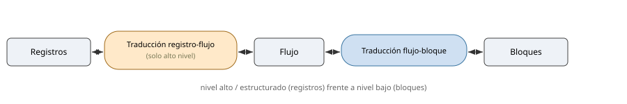
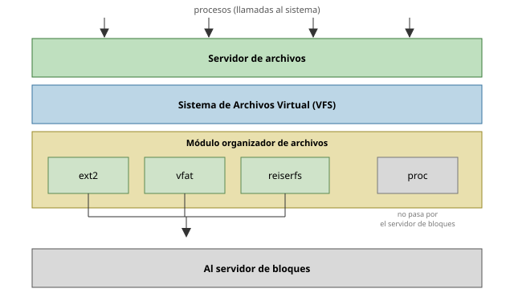

# Sistemas de ficheros: material adicional

## Objetivos del sistema de ficheros

El sistema de ficheros es un **servicio** para los usuarios: acceder directamente a los dispositivos es incómodo, requiere conocer detalles físicos, depende de direcciones físicas (no es seguro) y, a nivel físico, el usuario no tiene restricciones.

**Objetivos**: proporcionar mecanismos de **nombrado y localización** de datos no volátiles; ofrecer **primitivas de acceso** cómodas e independientes de los dispositivos; proporcionar **protección y seguridad**.

**Funciones**: fiabilidad (correcto almacenamiento y recuperación) · almacenamiento **permanente** y **estructurado** · privacidad (solo usuarios autorizados) · abstracción de los dispositivos físicos · accesibilidad mediante llamadas al sistema o librerías · **compartición** (acceso concurrente de usuarios autorizados).

## Ficheros estructurados en registros

UNIX, Linux y Windows ven un fichero como una secuencia de bytes; otros sistemas (VMS, los grandes sistemas de IBM, el Mac OS clásico) imponen una estructura de **registros**.

- **Bajo nivel**: el SO solo provee traducción **flujo‑bloque**; la estructuración de los datos recae en las aplicaciones.
- **Alto nivel / estructurado**: el SO provee además traducción **registro‑flujo**; requiere estructuras de datos específicas para el almacenamiento.

Primitivas de acceso en cada caso:

| Acceso de bajo nivel | Acceso estructurado (secuencial / orientado a registros) | Secuencial indexado |
|----------------------|---------------------------------------------------------|---------------------|
| `abrir(nombre_archivo)` | `abrir(nombre_archivo)` | `obtener_registro(id_archivo, indice)` |
| `cerrar(id_archivo)` | `cerrar(id_archivo)` | `poner_registro(id_archivo, registro)` |
| `leer(id_archivo, bufer, longitud)` | `obtener_registro(id_archivo, registro)` | `borrar_registro(id_archivo, indice)` |
| `escribir(id_archivo, bufer, longitud)` | `poner_registro(id_archivo, registro)` | |
| `buscar(id_archivo, posicion_archivo)` | `buscar(id_archivo, posicion_archivo)` | |

## Permisos en otros sistemas

- La mayoría de los sistemas de archivos modernos permiten asignar **permisos** a usuarios y grupos, restringiendo o permitiendo visualización, modificación y/o ejecución.
- **UNIX, Linux y macOS** usan el esquema simple de propietario, grupo y otros. Además, Linux y FreeBSD implementan las **listas de control de acceso (ACL)** del borrador POSIX.1e, y macOS tiene ACL propias.
- Las variantes de **DOS** no implementan ningún sistema de permisos.
- **Microsoft Windows**, así como VMS y OpenVMS, emplean **ACL** para un conjunto de permisos más complejo y variado.

## Formato de las entradas de directorio

| Sistema | Estructura de la entrada (bytes) |
|---------|--------------------------------|
| **UNIX clásico** | 2 (número del nodo‑i) + 14 (nombre del archivo) |
| **ext2/3/4** | 4 (número del nodo‑i) + 2 (longitud de la entrada) + 1 (longitud del nombre) + 1 (tipo) + nombre (hasta 255) |
| **MS‑DOS** | 8 (nombre) + 3 (extensión) + 1 (atributos) + 10 (reservado) + 2 (tiempo) + 2 (fecha) + 2 (primer número de bloque) + 4 (tamaño) |

En MS‑DOS (FAT) no hay nodos‑i: los metadatos van en la propia entrada de directorio.

## Gestión del espacio libre

| Método | Comentario |
|--------|-----------|
| **Mapas de bits** | Un bit por recurso (nodo‑i, bloque o agrupación) que indica si está libre u ocupado (el convenio depende del sistema; ext usa 1 = ocupado). Fácil y sencillo; eficiente si el dispositivo no está muy lleno ni muy fragmentado. |
| **Listas de recursos libres** | Lista enlazada con todos los recursos disponibles; los propios bloques libres guardan los números de otros bloques libres (un bloque de 1 KB contiene 512 números de bloque de 16 bits). Ineficiente salvo para dispositivos muy llenos y fragmentados. |
| **Uso de agrupaciones** | Gestión por unidades lógicas mayores. |

## Otras políticas de la caché de bloques

- **Políticas de reemplazo**: FIFO · segunda oportunidad · MRU (*Most Recently Used*) · **LRU** (la más frecuente). Con LRU estricto, un bloque crítico (un nodo‑i, un directorio) que se usa mucho no sale nunca de la caché y, con escritura diferida, nunca se escribiría: si el ordenador falla, el sistema de ficheros queda inconsistente. Por eso los bloques críticos se escriben de inmediato.
- **Escritura al cierre** (*write‑on‑close*): al cerrar un archivo, se vuelcan sus bloques actualizados.

## Sistemas de ficheros por sistema operativo

| SO | Sistemas de ficheros |
|----|----------------------|
| Unix | UFS (System V, BSD) |
| Linux | ext2, ext3, ext4, XFS, JFS, Btrfs (ReiserFS, ya retirado del kernel) |
| Solaris | UFS, ZFS, VxFS, QFS |
| macOS | APFS (antes HFS Plus) |
| Windows | NTFS, ReFS, FAT32, exFAT (antes FAT16) |

### Comparativa

| | FAT16 | FAT32 | HFS+ | ext3 | NTFS | ext4 |
|---|---|---|---|---|---|---|
| Año de creación | 1984 | 1996 | 1998 | 1999 | 1993 | 2006 |
| Empresa | Microsoft | Microsoft | Apple | Stephen Tweedie | Microsoft | Varios |
| SO inicial | MS‑DOS 3 | Windows 95 | Mac OS 8.1 | Linux 2.4.15 | Windows NT 3.1 | Linux 2.6.19 |
| Tamaño máx. de nombre | 8+3 | 8+3 (255 car. con VFAT) | 255 car. UTF‑16 | 255 bytes | 255 car. UTF‑16 | 255 bytes |
| Tamaño máx. de fichero | 2/4 GB | 4 GB | 8 EB | 2 TB | 16 EB | 16 TB |
| Tamaño máx. de partición | 2/4 GB | 2/16 TB | 8 EB | 32 TB | 16 EB | 1 EB |

### Características de algunos sistemas

| Sistema | Características |
|---------|----------------|
| **FAT32** | Estándar de facto para intercambio. Ficheros de hasta 4 GB; particiones de hasta 2 TB (16 TB con sectores de 4 KB); nombres largos en UTF‑16 gracias a la extensión VFAT; **sin permisos ni journaling**. Adecuado para memorias USB o discos externos, no para el disco interno. |
| **exFAT** | Tabla de Asignación de Archivos Extendida. Similar a FAT32 pero permite ficheros de más de 4 GB. Accesible en Linux, Windows y macOS. |
| **NTFS** | Journaling. Cifrado (**EFS**, *Encrypting File System*, con clave pública). Nombres en UTF‑16. Agrupaciones de 4 KB por defecto. Compresión. Permisos con ACL para ficheros y carpetas. |
| **EXT3** | Transaccional (*journal*). Compatible con EXT2. Bajo consumo de CPU. Límite del sistema de archivos: 2³² bloques. Hasta 32 000 subdirectorios por directorio. |
| **EXT4** | Transaccional. Volúmenes de hasta **1 EiB** y ficheros de hasta **16 TiB**. Más rápido que EXT3 y con menor consumo de CPU. Emplea **extents** (conjuntos de bloques físicos contiguos). **Asignación diferida** (*delayed allocation*): decide qué bloques usar al volcar al disco, no en cada `write`, para colocarlos contiguos. Permite montar sistemas EXT3. Sin límite práctico de subdirectorios. |

**Límites de EXT3 según el tamaño de bloque:**

| Tamaño de bloque | Tamaño máximo de archivo | Tamaño máximo del sistema de ficheros |
|------------------|--------------------------|--------------------------------------|
| 1 KiB | 16 GiB | 2 TiB |
| 2 KiB | 256 GiB | 8 TiB |
| 4 KiB | 2 TiB | 16 TiB |
| 8 KiB | 2 TiB | 32 TiB |

Sistemas de ficheros con journaling: ReiserFS/Reiser4, ext3, ext4 (Linux) · NTFS (Windows) · UFS con *logging* (Solaris) · XFS (IRIX/Linux) · JFS (IBM AIX, OS/2, Linux) · HFS+ (macOS).

## Fiabilidad: soluciones hardware y software

| Soluciones hardware | Soluciones software |
|---------------------|---------------------|
| Controladores que tratan los sectores con fallos | *Backups* (copias de respaldo) en discos y en cintas; *backups* incrementales |
| Discos con información **redundante (RAID)** | **Replicación** |

## Niveles de RAID

| Nivel | Técnica | Tolerancia a fallos | Notas |
|-------|---------|---------------------|-------|
| **RAID 0** | *Striping* (nivel de bloque) | **Ninguna** | Buen rendimiento de lectura/escritura; aprovecha toda la capacidad; discos homogéneos; si falla una unidad se pierden **todos** los datos. No para sistemas críticos. |
| **RAID 1** | *Mirroring* | 1 disco | Muy simple; lectura más rápida (de cualquiera de los dos), escritura como un solo disco; ante un fallo basta hacer una nueva copia; capacidad eficaz = **mitad**; el intercambio en caliente no siempre es posible. |
| **RAID 2** | *Striping* a nivel de **bit** + disco de paridad + código de **Hamming** | corrección de errores | Apenas se emplea; no atiende varias peticiones simultáneas (discos paralelos pero no independientes). |
| **RAID 3** | *Striping* a nivel de **byte** + disco de paridad dedicado | 1 disco | No se emplea; la controladora sincroniza los discos; tasas de transferencia muy altas; una petición ocupa todos los discos de datos. |
| **RAID 4** | *Striping* a nivel de **bloque** + disco de paridad dedicado | 1 disco | Mínimo 3 discos; permite varias lecturas simultáneas; el disco de paridad es el **cuello de botella**. |
| **RAID 5** | *Striping* a nivel de bloque + **paridad distribuida** | 1 disco | Mínimo 3 discos; bajo coste de redundancia; paridad por hardware o por software; las **escrituras son costosas**. |
| **RAID 6** | RAID 5 + **segundo bloque de paridad** | 2 discos | Amplía RAID 5; mínimo 4 discos. |
| **RAID 0+1** | *Mirror* de *stripes* | | Matriz anidada. |
| **RAID 1+0** (RAID 10) | *Stripe* de *mirrors* | | Matriz anidada. |
| **RAID 1E**, **RAID 50**, **RAID 100** | Matrices RAID combinadas | | Configuraciones híbridas. |

Información adicional: [Seagate — modos RAID](http://www.seagate.com/es/es/manuals/network-storage/business-storage-nas-os/raid-modes/) · [Wikipedia — RAID](https://es.wikipedia.org/wiki/RAID) · [prepressure.com — RAID](https://www.prepressure.com/library/technology/raid) · [IONOS — RAID](https://www.ionos.es/digitalguide/servidores/seguridad/raid/)

## VFS en capas

Bajo el **servidor de archivos** y el VFS, el **módulo organizador de archivos** integra los distintos sistemas (`ext2`, `vfat`, `reiserfs`, …, `proc`) y accede al **servidor de bloques**. Los sistemas sin disco, como `proc`, no pasan por el servidor de bloques.

